# Lab 01: Routing (Static Route dan OSPF)

Lab ini menghubungkan dua jaringan LAN lewat tiga router yang disusun berbentuk segitiga. Awalnya semua interface sudah punya IP, tapi routing belum ada, sehingga PC di LAN kiri tidak bisa menjangkau Server di LAN kanan. Masalah itu diselesaikan dua kali, pertama dengan static route (lengkap dengan jalur cadangan), lalu dengan OSPF.

Dibuat dengan Cisco Packet Tracer 8.2.2.

## Topologi

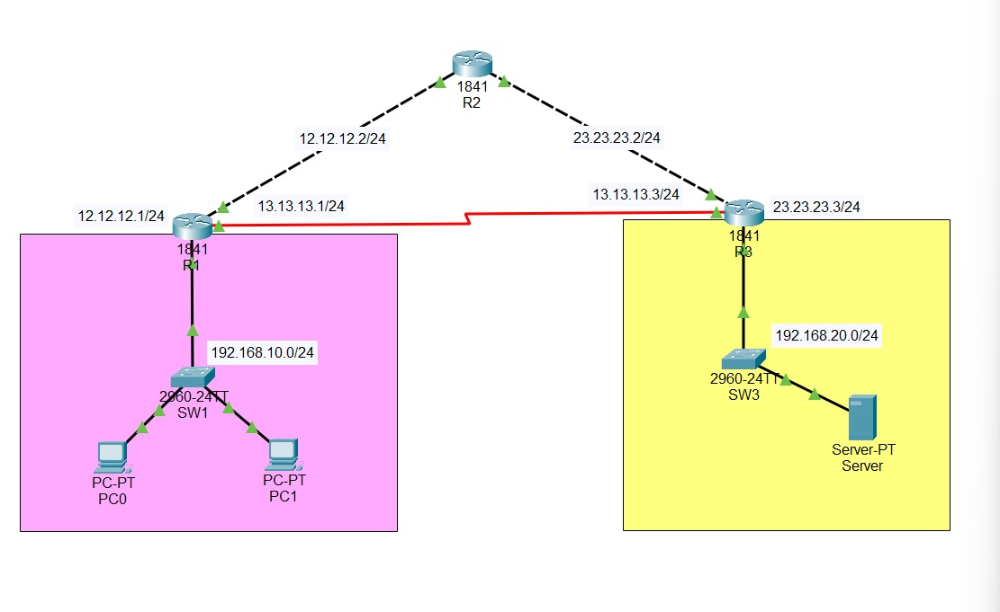

| Router | Interface | IP Address | Terhubung ke |
|---|---|---|---|
| R1 | Fa0/0 | 12.12.12.1/24 | R2 |
| R1 | Fa0/1 | 192.168.10.1/24 | LAN kiri (SW1, PC0, PC1) |
| R1 | Se0/0/0 | 13.13.13.1/24 | R3 |
| R1 | Loopback0 | 1.1.1.1/32 | |
| R2 | Fa0/0 | 12.12.12.2/24 | R1 |
| R2 | Fa0/1 | 23.23.23.2/24 | R3 |
| R2 | Loopback0 | 2.2.2.2/32 | |
| R3 | Fa0/0 | 23.23.23.3/24 | R2 |
| R3 | Fa0/1 | 192.168.20.1/24 | LAN kanan (SW3, Server) |
| R3 | Se0/0/0 | 13.13.13.3/24 | R1 |
| R3 | Loopback0 | 3.3.3.3/32 | |

Gateway PC0 dan PC1 adalah 192.168.10.1, gateway Server adalah 192.168.20.1.

## Isi folder

```text
01-routing/
├── lab-01-routing-static.pkt
├── lab-01-routing-ospf.pkt
├── screenshots/
├── configs/
└── README.md
```

## Kondisi awal

Sebelum routing dipasang, semua interface sudah up/up, tapi tabel routing hanya berisi rute connected. R1 tidak punya rute ke 192.168.20.0/24, jadi ping dari PC0 ke Server gagal.

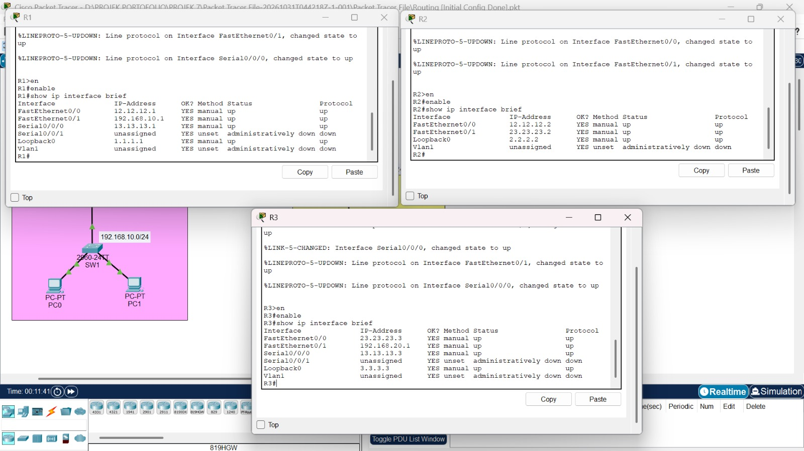

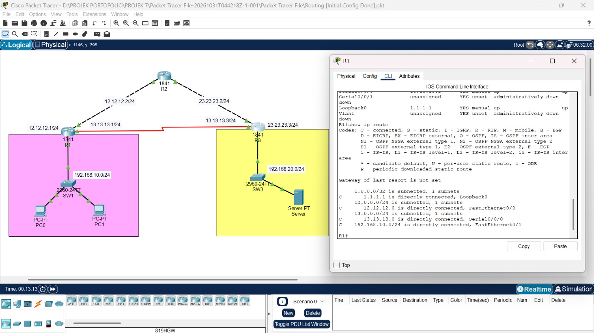

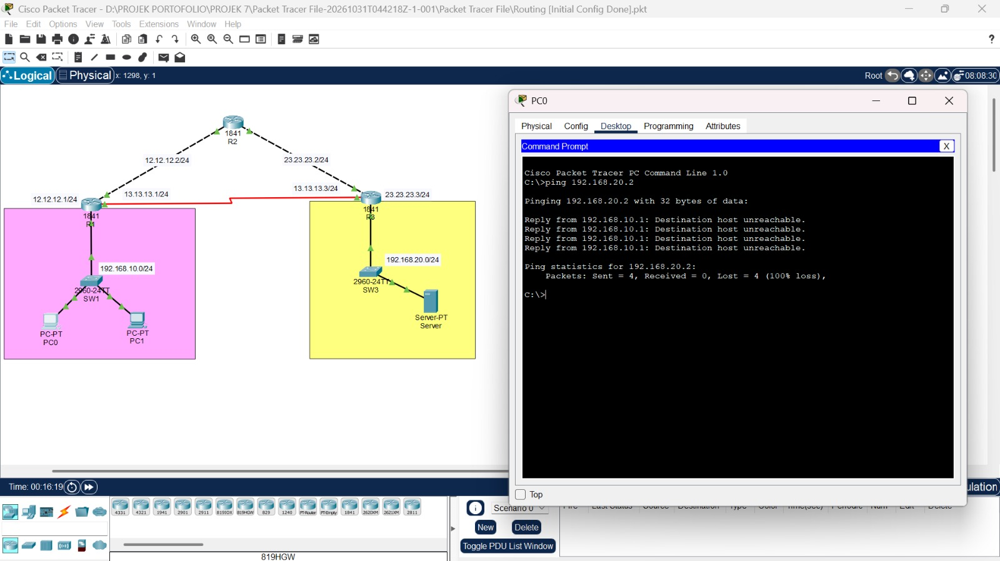

## Bagian 1: Static Route

Tiap router diberi tahu jalan ke LAN seberangnya secara manual. Jalur utama antara R1 dan R3 lewat kabel serial. Sebagai cadangan dipasang floating static route lewat R2 dengan administrative distance 10, sehingga hanya dipakai kalau jalur utama putus (nilai default static route adalah 1).

**R1**

```text
ip route 192.168.20.0 255.255.255.0 13.13.13.3
ip route 192.168.20.0 255.255.255.0 12.12.12.2 10
```

**R2**

```text
ip route 192.168.10.0 255.255.255.0 12.12.12.1
ip route 192.168.20.0 255.255.255.0 23.23.23.3
```

**R3**

```text
ip route 192.168.10.0 255.255.255.0 13.13.13.1
ip route 192.168.10.0 255.255.255.0 23.23.23.2 10
```

### Verifikasi

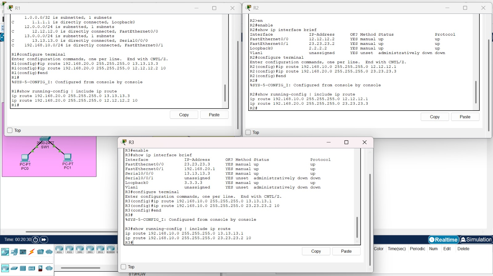

Di R1 dan R3, rute static muncul dengan kode `S` dan distance 1 lewat link serial.

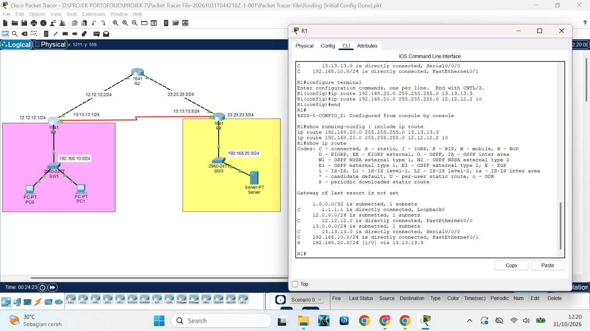

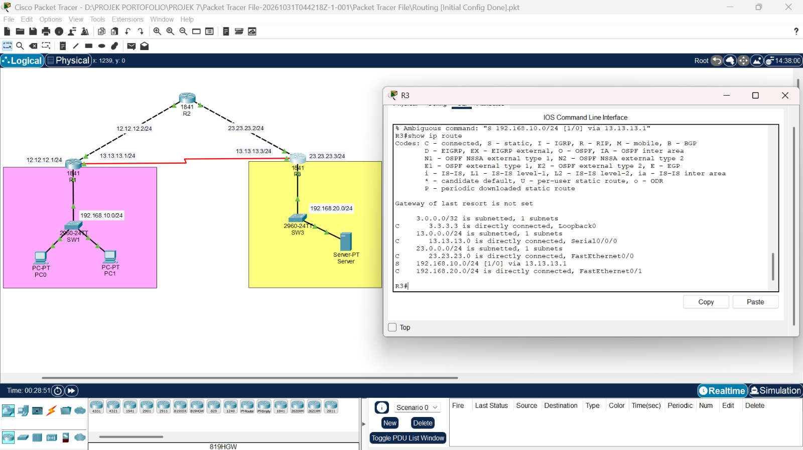

Ping dari PC0 ke Server berhasil, dan `tracert` hanya melewati R1 lalu R3.

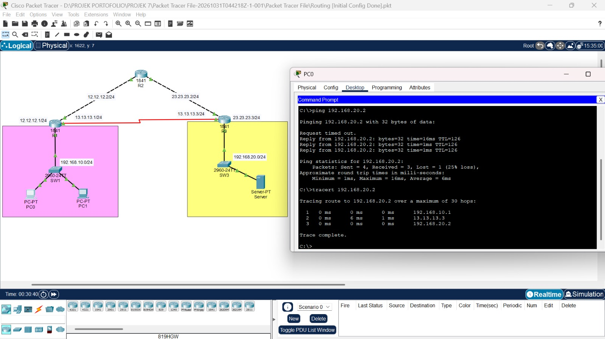

### Tes jalur cadangan

Interface Serial0/0/0 di R1 dimatikan dengan `shutdown`. Rute utama hilang, dan rute cadangan lewat R2 (distance 10) mengambil alih.

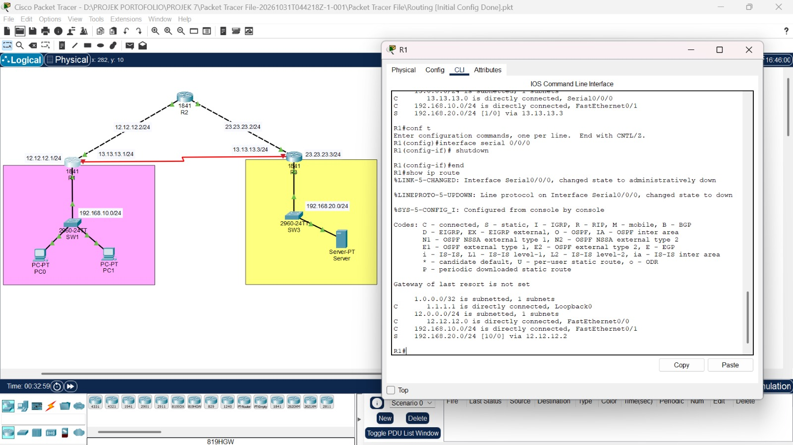

`tracert` sekarang melewati R2 sebelum sampai ke R3 dan Server.

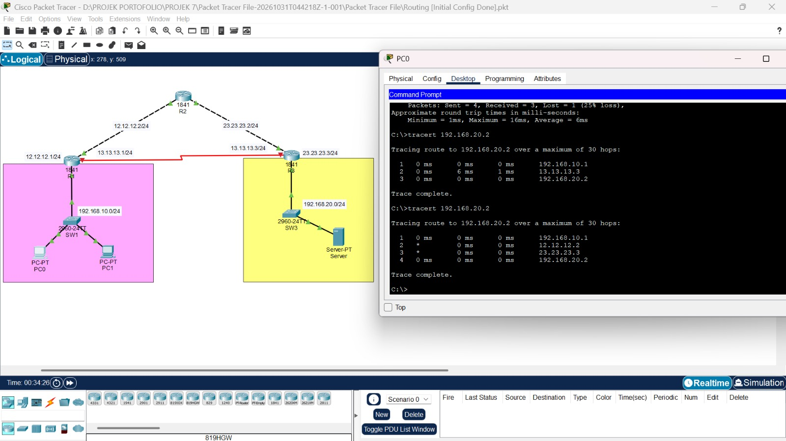

Setelah interface dinyalakan lagi, rute kembali memakai jalur utama.

## Bagian 2: OSPF

Static route dihapus, lalu ketiga router menjalankan OSPF process 1 di area 0. Interface LAN dijadikan passive supaya OSPF tidak mengirim pesan ke arah PC dan Server. Loopback ikut diumumkan untuk bahan tes tambahan.

**R1**

```text
no ip route 192.168.20.0 255.255.255.0 13.13.13.3
no ip route 192.168.20.0 255.255.255.0 12.12.12.2 10
router ospf 1
 router-id 1.1.1.1
 network 192.168.10.0 0.0.0.255 area 0
 network 12.12.12.0 0.0.0.255 area 0
 network 13.13.13.0 0.0.0.255 area 0
 network 1.1.1.1 0.0.0.0 area 0
 passive-interface FastEthernet0/1
```

**R2**

```text
no ip route 192.168.10.0 255.255.255.0 12.12.12.1
no ip route 192.168.20.0 255.255.255.0 23.23.23.3
router ospf 1
 router-id 2.2.2.2
 network 12.12.12.0 0.0.0.255 area 0
 network 23.23.23.0 0.0.0.255 area 0
 network 2.2.2.2 0.0.0.0 area 0
```

**R3**

```text
no ip route 192.168.10.0 255.255.255.0 13.13.13.1
no ip route 192.168.10.0 255.255.255.0 23.23.23.2 10
router ospf 1
 router-id 3.3.3.3
 network 192.168.20.0 0.0.0.255 area 0
 network 23.23.23.0 0.0.0.255 area 0
 network 13.13.13.0 0.0.0.255 area 0
 network 3.3.3.3 0.0.0.0 area 0
 passive-interface FastEthernet0/1
```

### Verifikasi

Tiap router membentuk dua neighbor dengan status FULL.

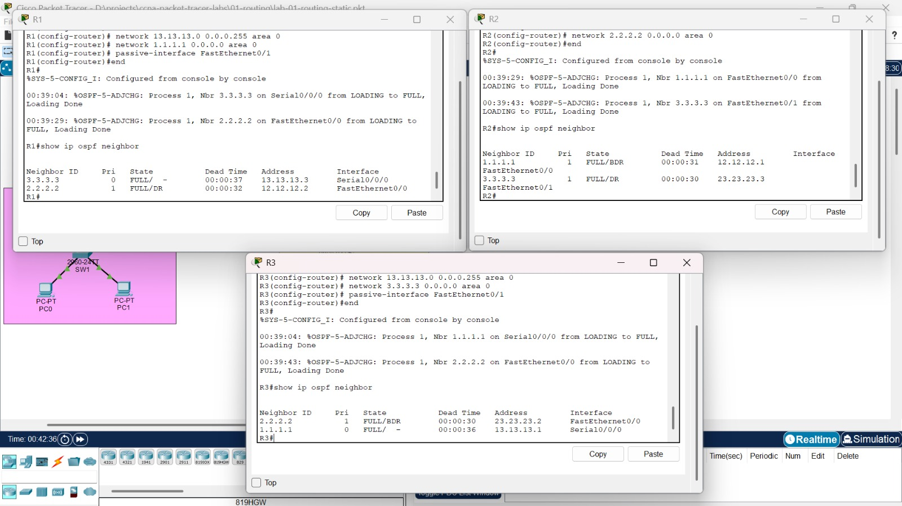

Di R1, rute ke LAN kanan dan ke loopback R2 dan R3 sekarang berkode `O`.

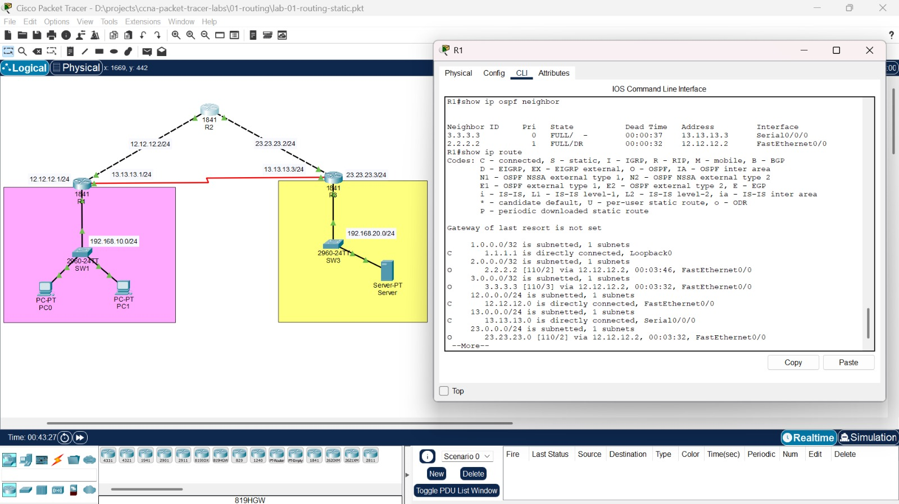

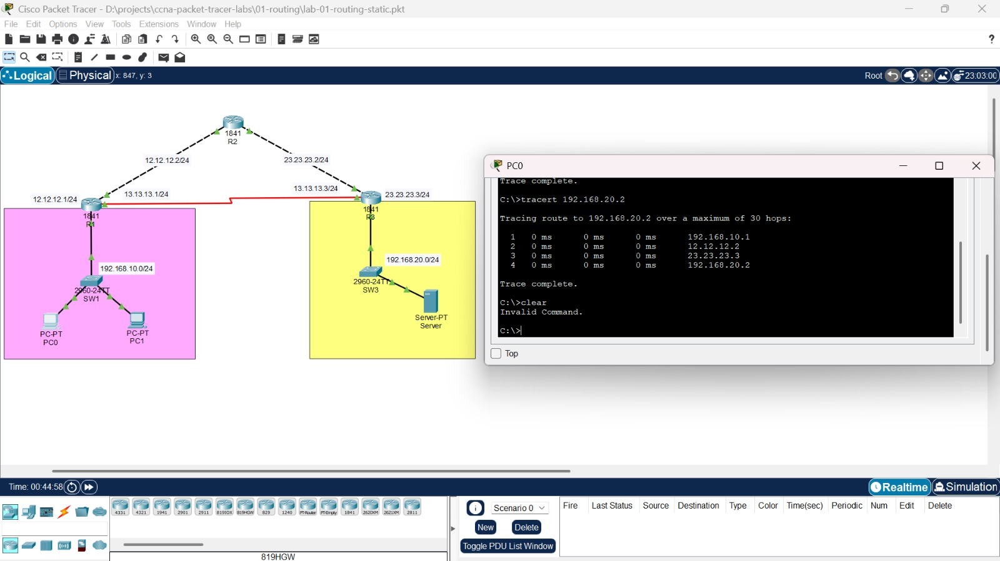

### Tes failover

Serial R1 dimatikan lagi. Kali ini perpindahan jalur ke R2 dilakukan OSPF sendiri, tanpa rute cadangan yang diketik manual.

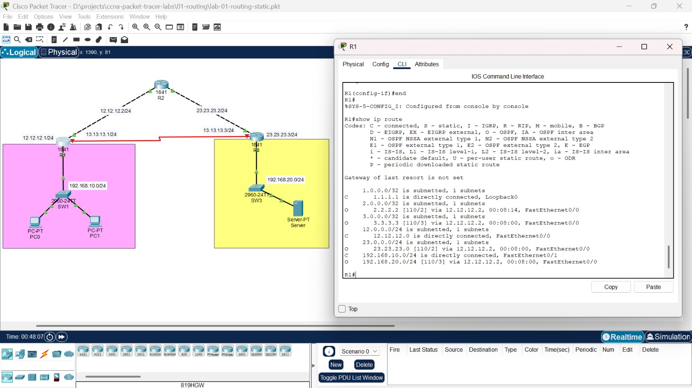

## Perbandingan

| | Static Route | OSPF |
|---|---|---|
| Cara kerja | Diketik manual di tiap router | Router bertukar informasi sendiri |
| Jalur cadangan | Harus dibuat manual (floating static) | Otomatis |
| Perubahan topologi | Konfigurasi harus diubah | Menyesuaikan sendiri |
| Cocok untuk | Jaringan kecil dan stabil | Jaringan yang lebih besar |

## Yang dipelajari

- Menulis static route dan floating static route dengan administrative distance
- Mengaktifkan OSPF single area, router-id, dan passive-interface
- Membaca tabel routing (kode `C`, `S`, `O`) dan memverifikasi jalur dengan `tracert`
- Menguji failover dengan mematikan interface

