# Lab 02: InterVLAN Routing dengan Router-on-a-Stick

Lab ini memisahkan jaringan menjadi dua VLAN pada dua switch, lalu menghubungkannya kembali lewat satu router. Router hanya punya satu kabel ke switch, tapi kabel itu dibagi menjadi dua subinterface, satu untuk tiap VLAN. Metode ini disebut router-on-a-stick.

Dibuat dengan Cisco Packet Tracer 8.2.2.

## Topologi

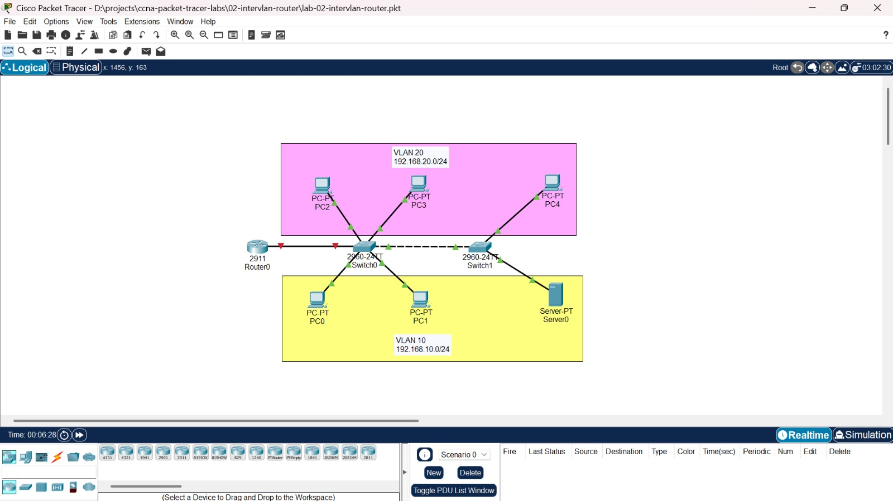

### VLAN dan IP Address

| VLAN | Subnet | Gateway | Perangkat |
|---|---|---|---|
| 10 | 192.168.10.0/24 | 192.168.10.1 | PC0, PC1, Server0 |
| 20 | 192.168.20.0/24 | 192.168.20.1 | PC2, PC3, PC4 |

| Perangkat | IP Address | Gateway |
|---|---|---|
| PC0 | 192.168.10.10 | 192.168.10.1 |
| PC1 | 192.168.10.11 | 192.168.10.1 |
| Server0 | 192.168.10.100 | 192.168.10.1 |
| PC2 | 192.168.20.10 | 192.168.20.1 |
| PC3 | 192.168.20.11 | 192.168.20.1 |
| PC4 | 192.168.20.12 | 192.168.20.1 |

### Koneksi port

| Kabel | Port | Mode |
|---|---|---|
| Router0 ke Switch0 | Router0 Gi0/0 ke Switch0 Gig0/2 | Trunk |
| Switch0 ke Switch1 | Switch0 Gig0/1 ke Switch1 Gig0/1 | Trunk |
| PC0, PC1 | Switch0 Fa0/1, Fa0/2 | Access VLAN 10 |
| PC2, PC3 | Switch0 Fa0/3, Fa0/4 | Access VLAN 20 |
| Server0 | Switch1 Fa0/1 | Access VLAN 10 |
| PC4 | Switch1 Fa0/2 | Access VLAN 20 |

## Isi folder

```text
02-intervlan-router/
├── lab-02-intervlan-router.pkt
├── screenshots/
├── configs/
│   ├── router0.txt
│   ├── switch0.txt
│   └── switch1.txt
└── README.md
```

## Kondisi awal

File awal hanya berisi topologi. Switch belum punya VLAN selain bawaan, dan interface Router0 masih mati.

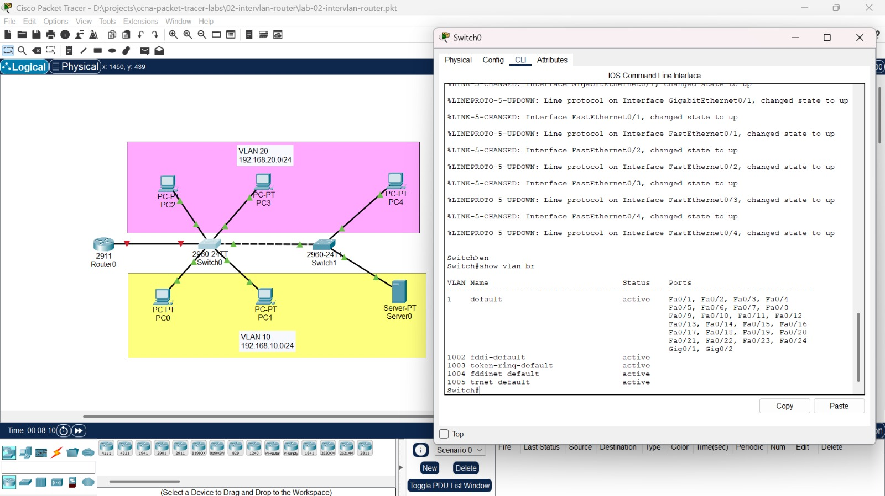

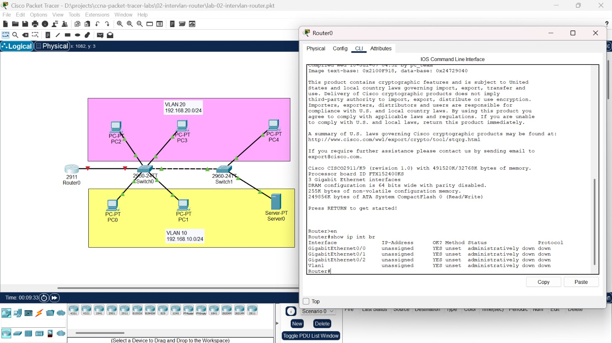

## Konfigurasi

### 1. VLAN dan access port

VLAN dibuat di kedua switch, lalu port yang menghadap PC dimasukkan ke VLAN yang sesuai.

**Switch0**

```text
hostname Switch0
vlan 10
 name VLAN10
vlan 20
 name VLAN20
interface range fastEthernet 0/1 - 2
 switchport mode access
 switchport access vlan 10
interface range fastEthernet 0/3 - 4
 switchport mode access
 switchport access vlan 20
```

**Switch1**

```text
hostname Switch1
vlan 10
 name VLAN10
vlan 20
 name VLAN20
interface fastEthernet 0/1
 switchport mode access
 switchport access vlan 10
interface fastEthernet 0/2
 switchport mode access
 switchport access vlan 20
```

### 2. Trunk

Jalur antar switch dan jalur ke router dijadikan trunk supaya bisa membawa VLAN 10 dan 20 sekaligus.

**Switch0**

```text
interface gigabitEthernet 0/1
 switchport mode trunk
interface gigabitEthernet 0/2
 switchport mode trunk
```

**Switch1**

```text
interface gigabitEthernet 0/1
 switchport mode trunk
```

### 3. Router-on-a-stick

Interface fisik Gi0/0 hanya dinyalakan tanpa IP. Dua subinterface dibuat dengan encapsulation dot1Q sesuai nomor VLAN, dan IP di subinterface menjadi gateway untuk VLAN-nya.

**Router0**

```text
hostname Router0
interface gigabitEthernet 0/0
 no shutdown
interface gigabitEthernet 0/0.10
 encapsulation dot1Q 10
 ip address 192.168.10.1 255.255.255.0
interface gigabitEthernet 0/0.20
 encapsulation dot1Q 20
 ip address 192.168.20.1 255.255.255.0
```

## Verifikasi

### VLAN

Port terdaftar di VLAN yang benar pada kedua switch.

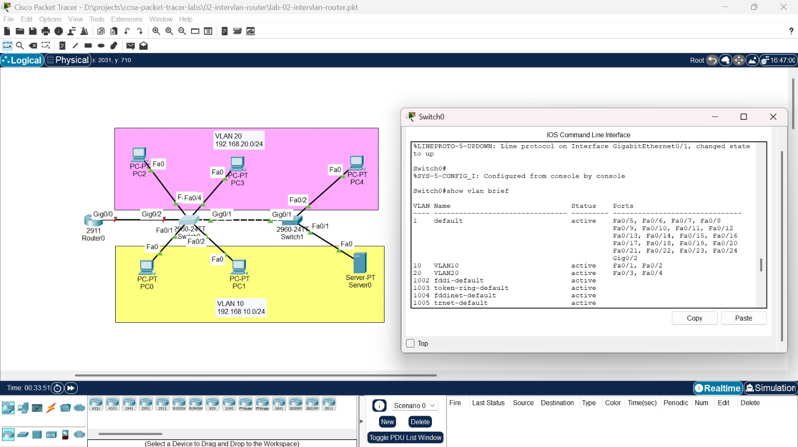

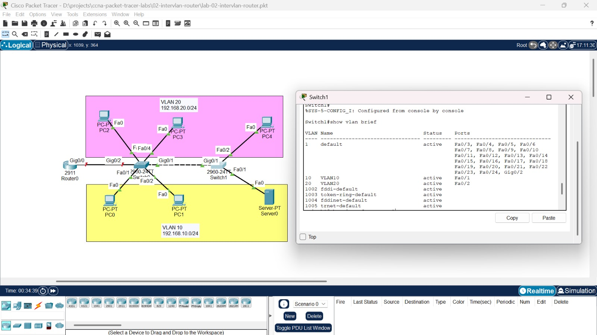

### Trunk

Switch0 menampilkan dua trunk (Gig0/1 ke Switch1 dan Gig0/2 ke router), sedangkan Switch1 menampilkan satu trunk. Catatan: Gig0/2 baru muncul di `show interfaces trunk` setelah interface Router0 dinyalakan, karena trunk hanya ditampilkan kalau link-nya aktif.

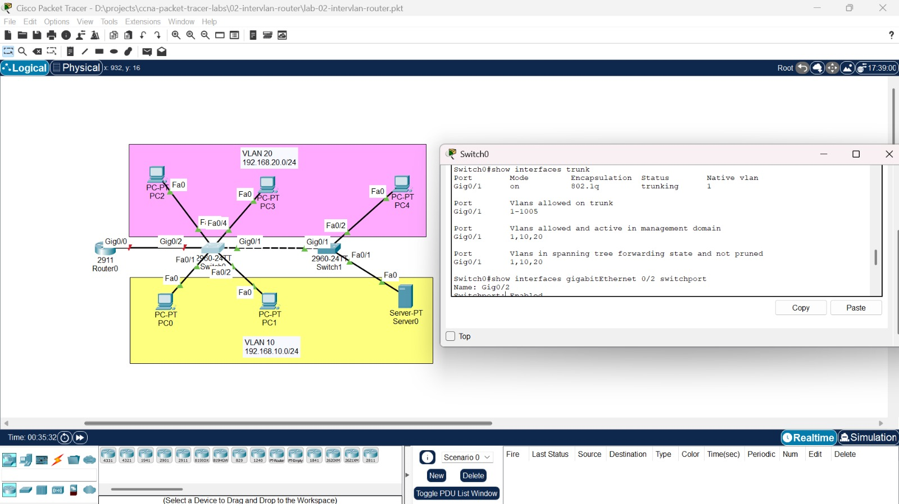

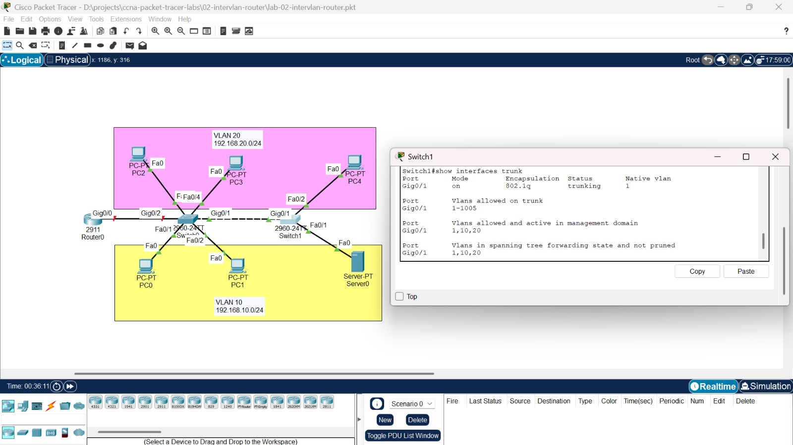

### Konfigurasi IP di perangkat

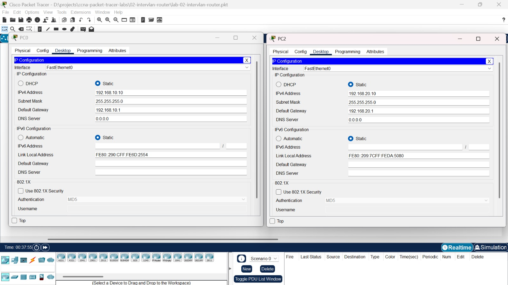

## Tes

### Sebelum router dikonfigurasi

Ping dalam satu VLAN berhasil, termasuk ke Server0 yang berada di switch lain (bukti trunk antar switch bekerja). Ping ke VLAN lain gagal karena belum ada yang menjembatani kedua VLAN.

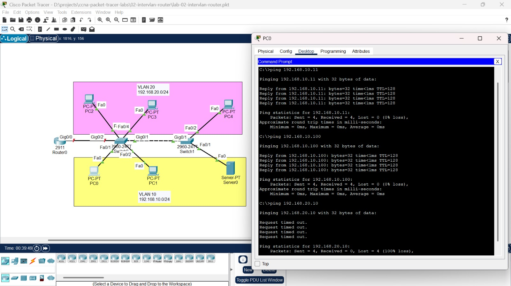

### Setelah router dikonfigurasi

Kedua subinterface aktif dan masing-masing membawa satu subnet.

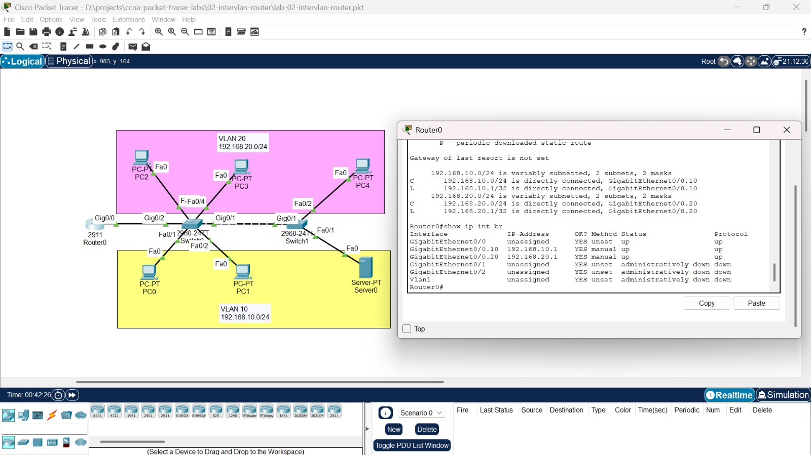

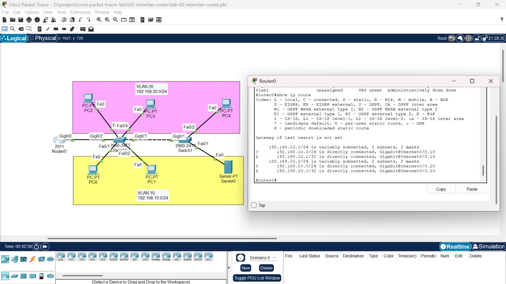

Ping antar VLAN sekarang berhasil.

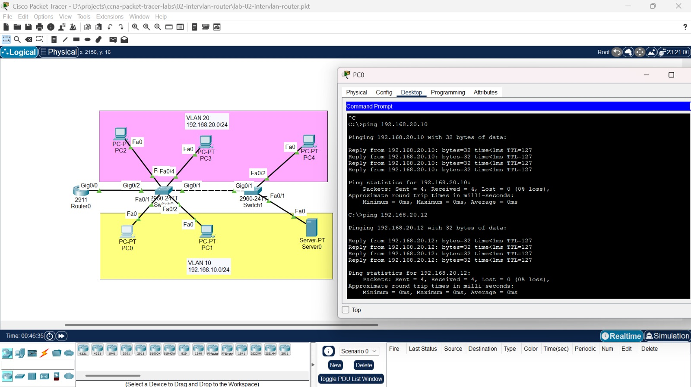

`tracert` dari PC0 ke PC2 melewati gateway 192.168.10.1 di router, lalu langsung ke tujuan.

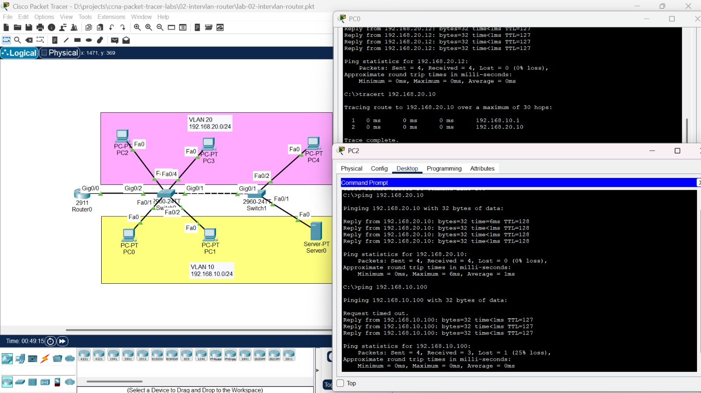

## Yang dipelajari

- Membuat VLAN dan menempatkan port ke VLAN dengan mode access
- Membedakan access port dan trunk port, serta membaca `show vlan brief` dan `show interfaces trunk`
- Mengonfigurasi router-on-a-stick dengan subinterface dan encapsulation dot1Q
- Menguji dan membuktikan bahwa perangkat beda VLAN baru bisa berkomunikasi setelah ada router

