# Lab 03: InterVLAN Routing dengan Multilayer Switch dan DHCP

Lab ini memakai satu multilayer switch (Cisco 3560) untuk dua tugas sekaligus: melakukan routing antar VLAN lewat SVI, dan meneruskan permintaan DHCP dari PC ke server yang berada di VLAN lain. Tidak ada router di topologi ini, karena switch-nya sendiri yang bertindak sebagai gateway.

Dibuat dengan Cisco Packet Tracer 8.2.2.

## Topologi

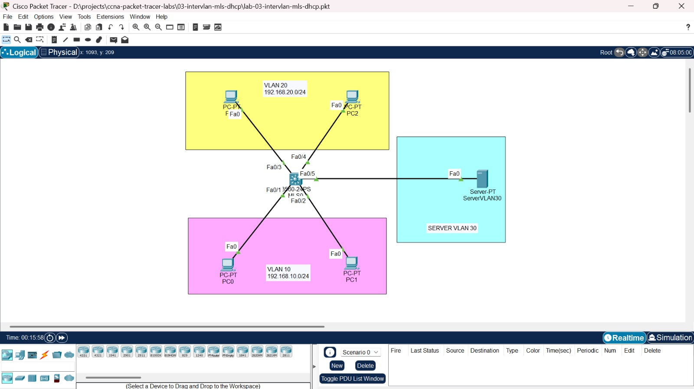

### VLAN dan IP Address

| VLAN | Nama | Subnet | Gateway (SVI) | Perangkat |
|---|---|---|---|---|
| 10 | VLAN10 | 192.168.10.0/24 | 192.168.10.1 | PC0, PC1 |
| 20 | VLAN20 | 192.168.20.0/24 | 192.168.20.1 | PC3, PC2 |
| 30 | SERVER | 192.168.30.0/24 | 192.168.30.1 | ServerVLAN30 (192.168.30.10) |

PC di VLAN 10 dan 20 mendapat IP otomatis dari DHCP server di VLAN 30. Server memakai IP static.

### Koneksi port

| Port | Perangkat | VLAN |
|---|---|---|
| Fa0/1 | PC0 | 10 |
| Fa0/2 | PC1 | 10 |
| Fa0/3 | PC3 | 20 |
| Fa0/4 | PC2 | 20 |
| Fa0/5 | ServerVLAN30 | 30 |

## Isi folder

```text
03-intervlan-mls-dhcp/
├── lab-03-intervlan-mls-dhcp.pkt
├── screenshots/
├── configs/
│   └── mls0.txt
└── README.md
```

## Konsep singkat

- **SVI (Switch Virtual Interface)** adalah interface virtual di switch untuk satu VLAN. Diberi IP, ia menjadi gateway VLAN itu. Agar switch bisa meneruskan paket antar SVI, perintah `ip routing` harus aktif.
- **DHCP relay** diperlukan karena permintaan DHCP dikirim secara broadcast, dan broadcast tidak menyeberang antar VLAN. Perintah `ip helper-address` di SVI mengubah broadcast itu menjadi paket langsung ke IP DHCP server.

## Kondisi awal

File awal hanya berisi topologi, tanpa VLAN.

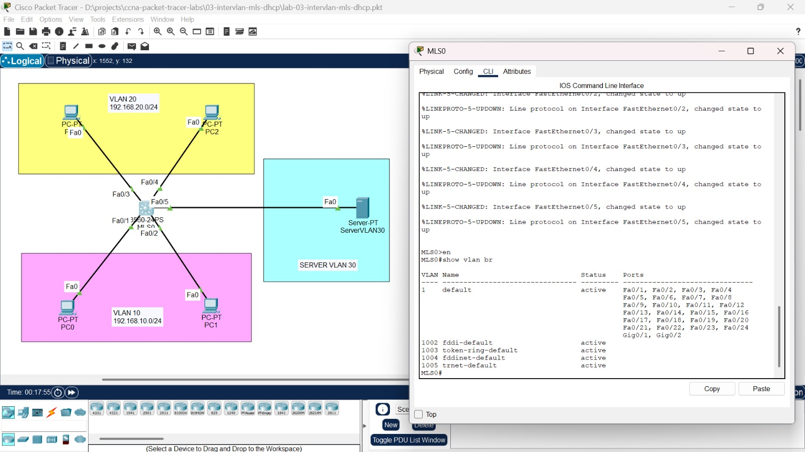

## Konfigurasi

### 1. VLAN dan access port

```text
hostname MLS0
vlan 10
 name VLAN10
vlan 20
 name VLAN20
vlan 30
 name SERVER
interface range fastEthernet 0/1 - 2
 switchport mode access
 switchport access vlan 10
interface range fastEthernet 0/3 - 4
 switchport mode access
 switchport access vlan 20
interface fastEthernet 0/5
 switchport mode access
 switchport access vlan 30
```

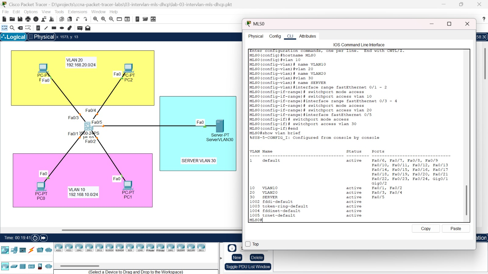

### 2. Routing antar VLAN dengan SVI

```text
ip routing
interface vlan 10
 ip address 192.168.10.1 255.255.255.0
 no shutdown
interface vlan 20
 ip address 192.168.20.1 255.255.255.0
 no shutdown
interface vlan 30
 ip address 192.168.30.1 255.255.255.0
 no shutdown
```

Ketiga SVI berstatus up/up, dan tabel routing berisi tiga rute connected.

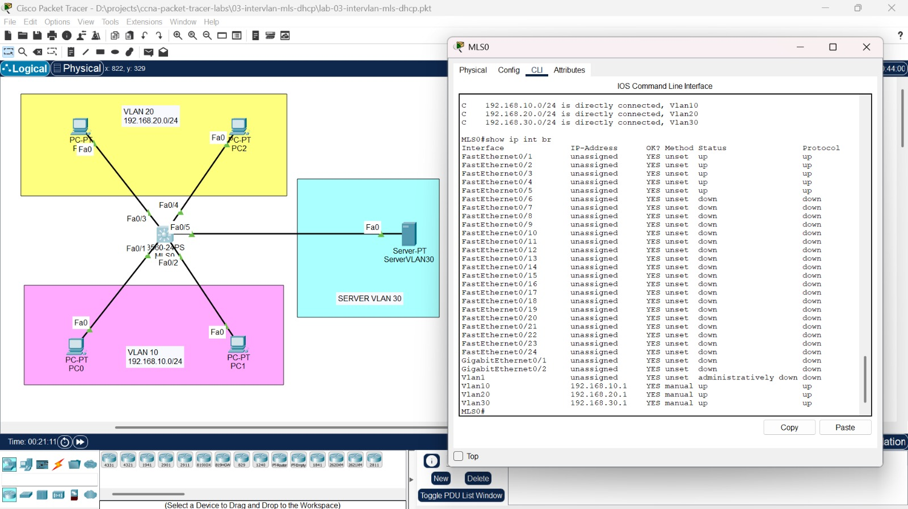

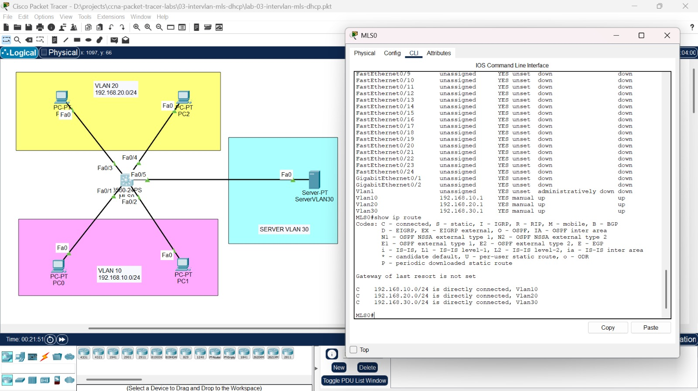

### 3. DHCP server

Server memakai IP static 192.168.30.10 (gateway 192.168.30.1). Layanan DHCP di server diaktifkan dengan dua pool.

| Pool | Default Gateway | DNS | Start IP | Subnet Mask | Max User |
|---|---|---|---|---|---|
| VLAN10 | 192.168.10.1 | 192.168.30.10 | 192.168.10.10 | 255.255.255.0 | 50 |
| VLAN20 | 192.168.20.1 | 192.168.30.10 | 192.168.20.10 | 255.255.255.0 | 50 |

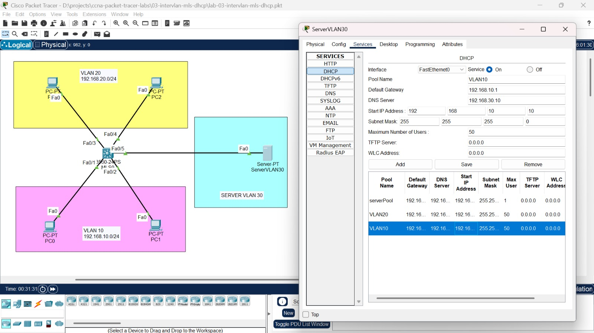

### Sebelum helper-address

Meskipun DHCP server sudah aktif, PC masih gagal mendapat IP, karena permintaan broadcast-nya tidak sampai ke VLAN 30.

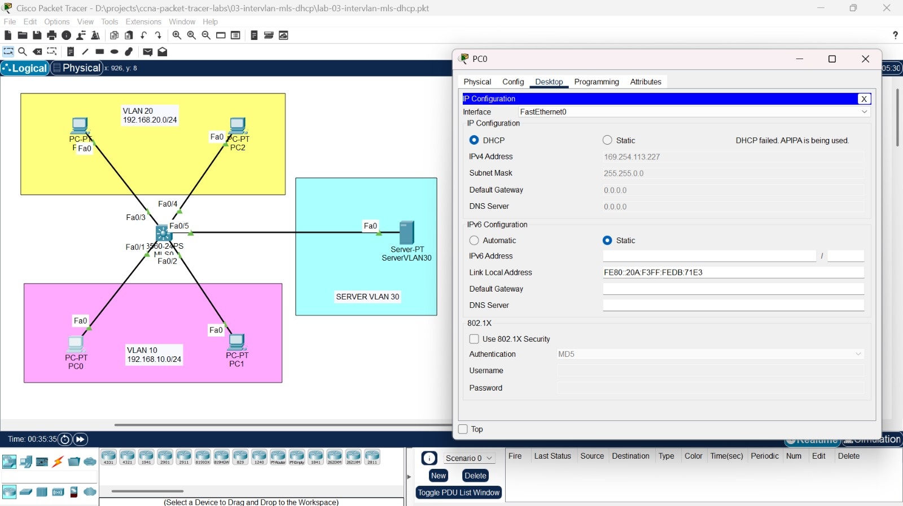

### 4. DHCP relay

```text
interface vlan 10
 ip helper-address 192.168.30.10
interface vlan 20
 ip helper-address 192.168.30.10
```

Perintah ini dipasang di SVI VLAN 10 dan 20, yaitu VLAN tempat client berada.

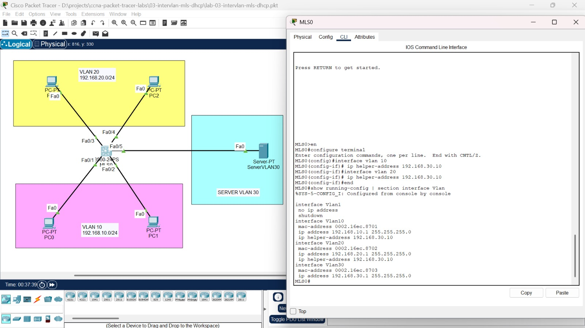

## Verifikasi

Setelah helper-address dipasang, PC di VLAN 10 mendapat IP dari pool VLAN10 dan PC di VLAN 20 mendapat IP dari pool VLAN20, lengkap dengan gateway masing-masing.

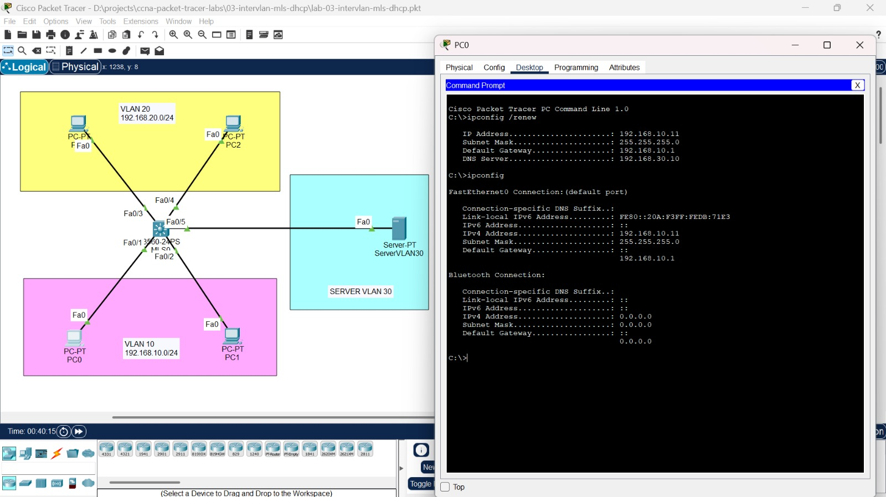

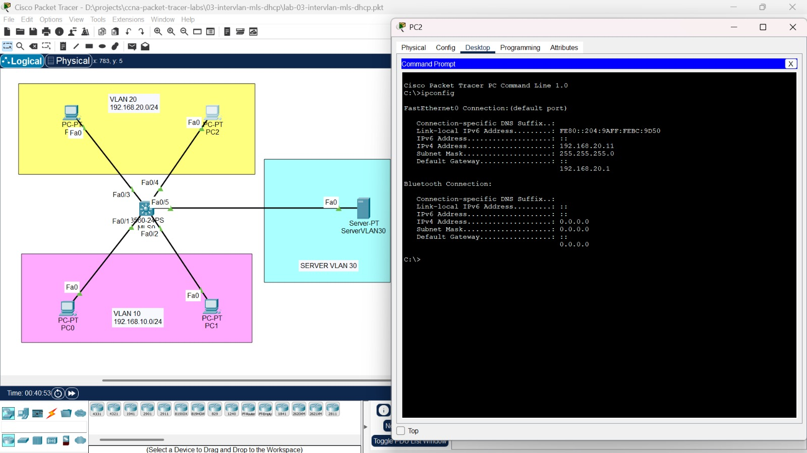

Ping antar VLAN, termasuk ke server, berhasil.

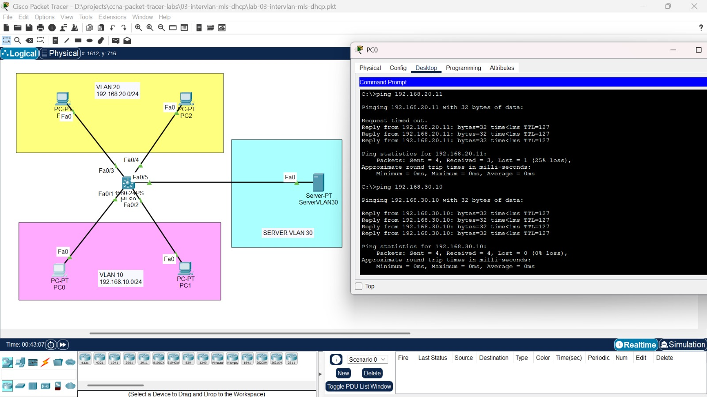

`tracert` dari PC0 ke PC2 melewati gateway 192.168.10.1 di switch, lalu langsung ke tujuan.

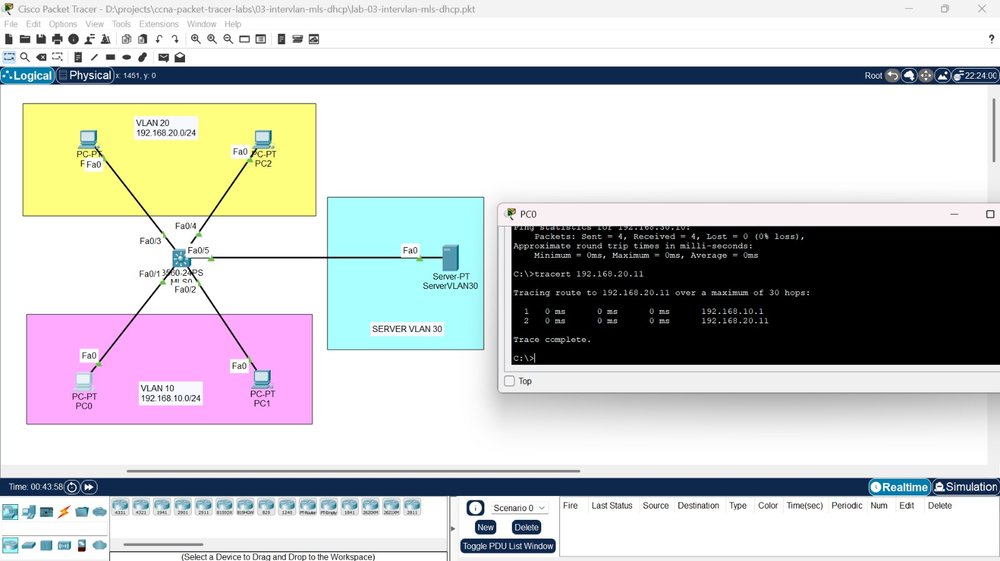

## Yang dipelajari

- Mengaktifkan routing di multilayer switch dengan `ip routing` dan membuat SVI sebagai gateway tiap VLAN
- Menempatkan server di VLAN terpisah dan memberi IP static
- Mengonfigurasi DHCP server dengan beberapa pool, satu per VLAN
- Memahami mengapa DHCP tidak jalan antar VLAN tanpa relay, dan memperbaikinya dengan `ip helper-address`

