# Lab 04: Spanning Tree Protocol (STP)

Lab ini membahas cara STP mencegah loop pada topologi switch yang punya jalur ganda. Pada kondisi default, root bridge dipilih dari MAC address terkecil, dan hasilnya jatuh ke salah satu switch access. Lab ini menetapkan root bridge secara manual di switch core, mengaktifkan Rapid PVST, lalu membuktikan lewat uji link putus bahwa jalur cadangan langsung aktif.

Dibuat dengan Cisco Packet Tracer 8.2.2.

## Topologi

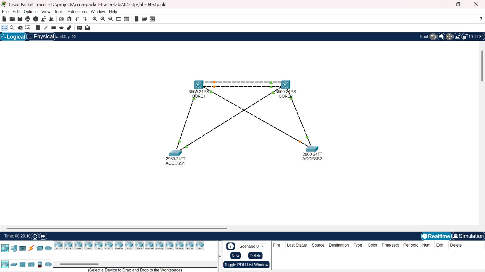

Dua switch core (CORE1, CORE2) dihubungkan dengan dua kabel, dan setiap switch access (ACCESS1, ACCESS2) terhubung ke kedua core. Topologi ini penuh loop, jadi tanpa STP frame akan berputar terus (broadcast storm).

| Kabel | Ujung 1 | Ujung 2 |
|---|---|---|
| CORE1 ke CORE2 | CORE1 Fa0/3 | CORE2 Fa0/3 |
| CORE1 ke CORE2 | CORE1 Fa0/4 | CORE2 Fa0/4 |
| CORE1 ke ACCESS1 | CORE1 Fa0/1 | ACCESS1 Fa0/1 |
| CORE1 ke ACCESS2 | CORE1 Fa0/2 | ACCESS2 Fa0/1 |
| CORE2 ke ACCESS1 | CORE2 Fa0/1 | ACCESS1 Fa0/2 |
| CORE2 ke ACCESS2 | CORE2 Fa0/2 | ACCESS2 Fa0/2 |

Perangkat: CORE1 dan CORE2 (Cisco 3560-24PS), ACCESS1 dan ACCESS2 (Cisco 2960-24TT). Semua link berada di VLAN 1.

## Isi folder

```text
04-stp/
├── lab-04-stp.pkt
├── screenshots/
├── configs/
│   ├── core1.txt
│   ├── core2.txt
│   ├── access1.txt
│   └── access2.txt
└── README.md
```

## Konsep singkat

- **Root bridge** adalah switch acuan. Semua switch lain mencari jalur terbaik menuju root. Root dipilih dari bridge priority terkecil, dan kalau sama, dari MAC address terkecil.
- **Root port** adalah port di switch non-root yang menjadi jalur terbaik menuju root.
- **Designated port** adalah port yang meneruskan lalu lintas pada sebuah segmen.
- **Alternate port** adalah port yang diblok sebagai cadangan. Port ini aktif kalau jalur utama putus.
- Priority harus kelipatan 4096. Nomor VLAN ditambahkan ke angka itu, jadi priority 4096 pada VLAN 1 tampil sebagai 4097.

## Kondisi default

Sebelum ada konfigurasi apa pun, semua switch memakai priority 32768 (tampil 32769). Root bridge yang terpilih adalah **ACCESS1**, karena MAC address-nya paling kecil (0001.63A8.4142).

| Switch | Root port | Port diblok | Catatan |
|---|---|---|---|
| ACCESS1 | tidak ada | tidak ada | Root bridge |
| CORE1 | Fa0/1 (ke ACCESS1) | Fa0/3 dan Fa0/4 (ke CORE2) | |
| CORE2 | Fa0/1 (ke ACCESS1) | tidak ada | |
| ACCESS2 | Fa0/2 (ke CORE2) | Fa0/1 (ke CORE1) | Cost ke root 38 |

Hasil ini tidak ideal. Root bridge ada di switch pinggir, dan ACCESS2 harus melewati dua lompatan (lewat CORE2, lalu ACCESS1) untuk mencapai root, sehingga cost-nya 38.

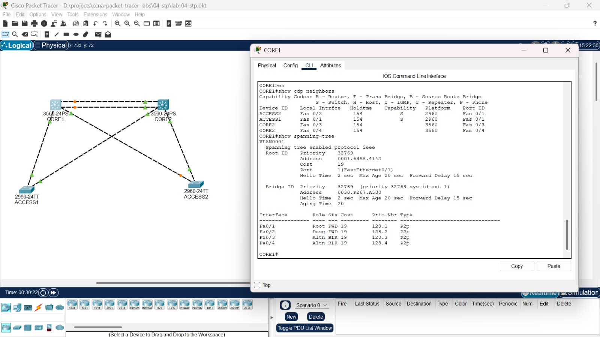

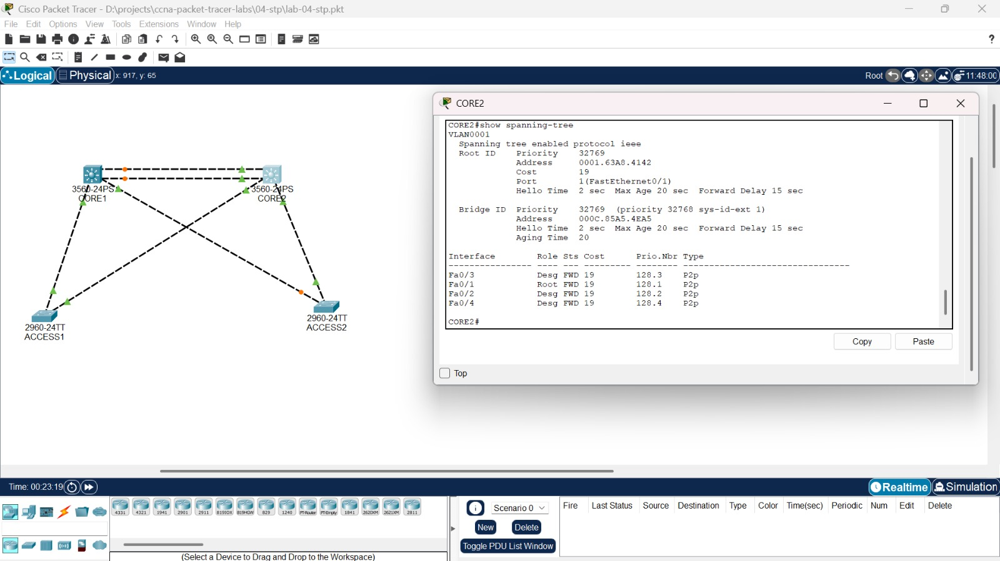

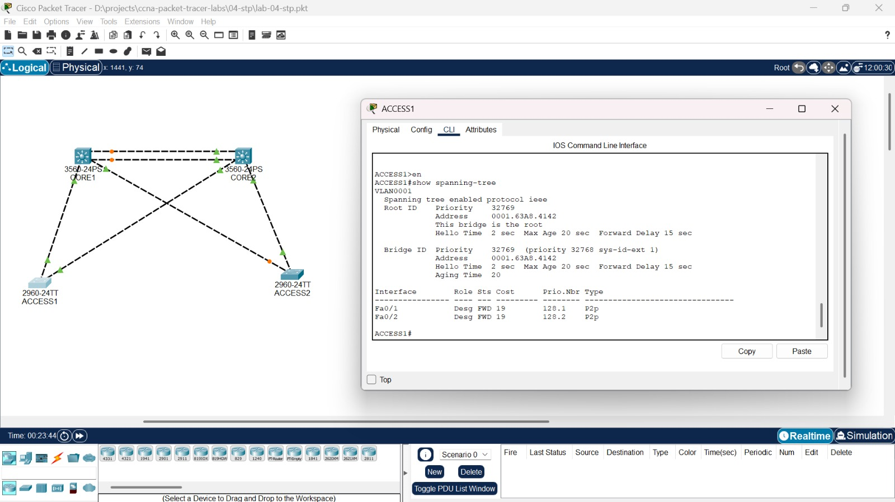

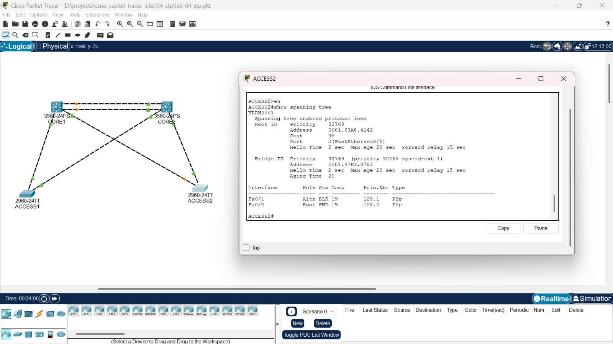

## Konfigurasi

CORE1 diberi priority 4096 supaya menjadi root bridge. CORE2 diberi priority 8192 supaya menjadi pengganti kalau CORE1 mati. Switch access dibiarkan di priority default agar tidak pernah terpilih sebagai root. Keempat switch dipindah ke Rapid PVST, yang memulihkan jalur dalam hitungan detik, jauh lebih cepat dari STP klasik.

**CORE1**

```text
spanning-tree mode rapid-pvst
spanning-tree vlan 1 priority 4096
```

**CORE2**

```text
spanning-tree mode rapid-pvst
spanning-tree vlan 1 priority 8192
```

**ACCESS1 dan ACCESS2**

```text
spanning-tree mode rapid-pvst
```

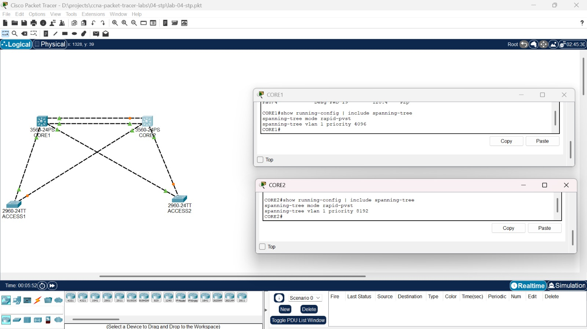

## Verifikasi

Setelah konfigurasi, CORE1 menjadi root bridge dan jalur setiap switch berubah.

| Switch | Hasil |
|---|---|
| CORE1 | Root bridge (priority 4097), semua port designated dan forwarding |
| CORE2 | Fa0/3 root port, Fa0/4 alternate (blocking), Fa0/1 dan Fa0/2 designated |
| ACCESS1 | Fa0/1 root port (ke CORE1), Fa0/2 alternate (ke CORE2) |
| ACCESS2 | Fa0/1 root port (ke CORE1), Fa0/2 alternate (ke CORE2) |

Cost ACCESS2 ke root turun dari 38 menjadi 19, karena sekarang ia terhubung langsung ke root.

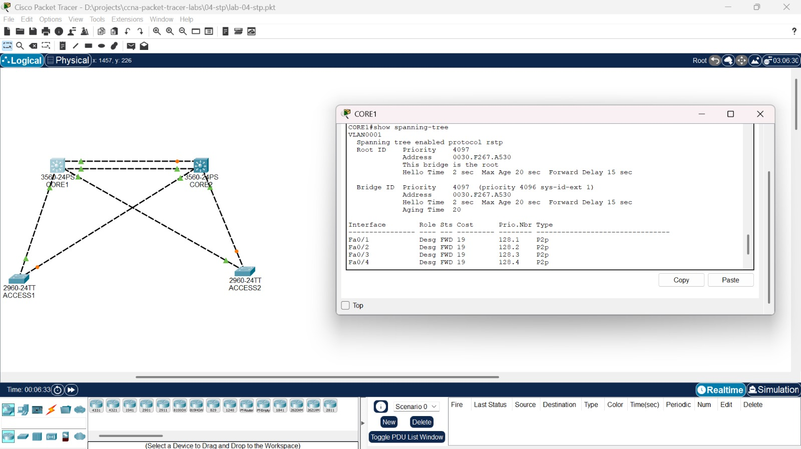

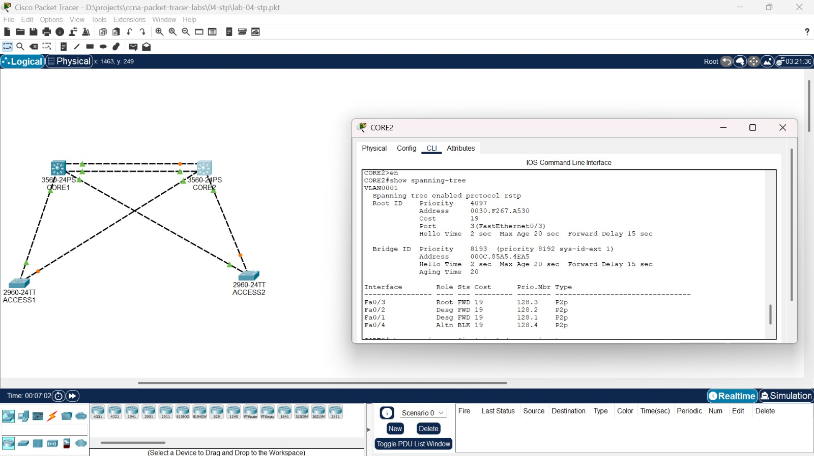

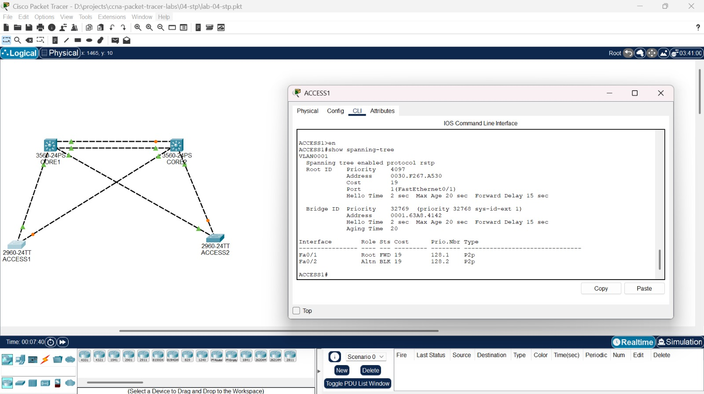

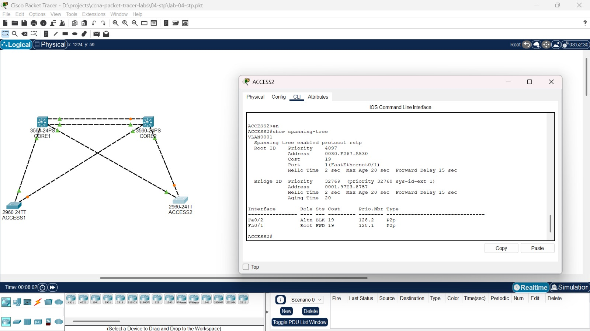

Titik oranye di topologi menandai port yang sedang blocking, dan titik hijau menandai port yang forwarding. Setiap switch access punya satu jalur aktif dan satu jalur cadangan, sehingga jaringan punya redundansi tanpa loop.

## Tes failover

Jalur utama ACCESS1 (Fa0/1 ke CORE1) dimatikan untuk melihat apakah jalur cadangan langsung aktif.

Sebelum link dimatikan, Fa0/1 berperan sebagai root port dan Fa0/2 sebagai alternate port.

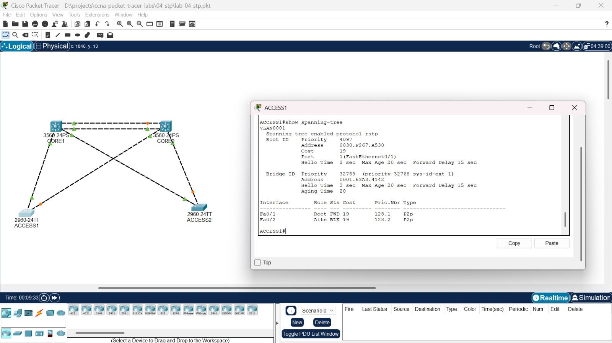

Setelah `shutdown` pada Fa0/1, Fa0/2 berpindah menjadi root port dan mulai forwarding.

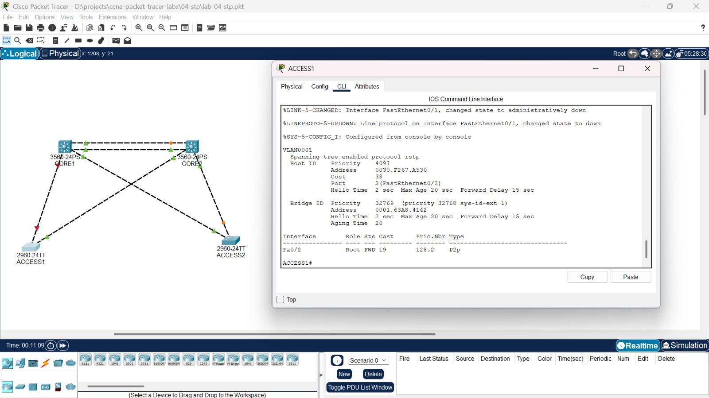

Setelah link dinyalakan kembali, kondisi kembali seperti semula.

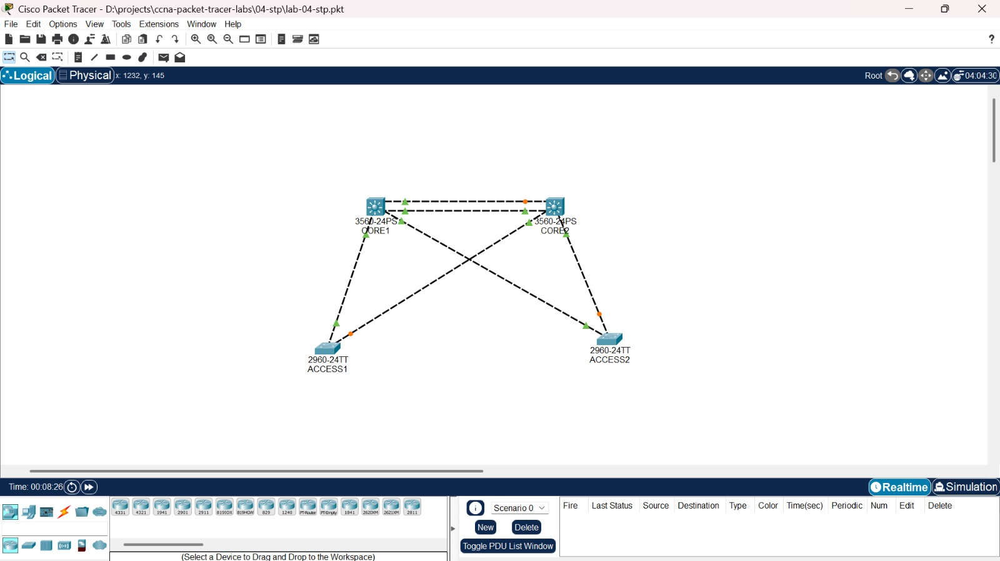

## Catatan

Setelah mode STP diganti ke Rapid PVST, tampilan `show spanning-tree` di Packet Tracer sempat tidak konsisten (CORE2 masih mengaku sebagai root, dan beberapa port tertulis designated padahal seharusnya root). Kondisi ini baru benar setelah switch di-reload dengan konfigurasi yang sudah disimpan. Perilaku ini khas simulator, dan di perangkat sungguhan konvergensinya berjalan sendiri.

## Yang dipelajari

- Membaca output `show spanning-tree`: Root ID, Bridge ID, role port (Root, Desg, Altn), dan status (FWD, BLK)
- Memahami bahwa root bridge default ditentukan MAC address dan bisa jatuh ke switch yang tidak tepat
- Menetapkan root bridge dan cadangannya dengan bridge priority
- Mengaktifkan Rapid PVST dan membuktikan perpindahan jalur lewat uji link putus

