# Lab 05: Link Aggregation (EtherChannel dengan LACP)

Lab ini menggabungkan dua kabel fisik menjadi satu link logis (Port-channel) memakai LACP. Ada dua bagian: EtherChannel Layer 2 berupa trunk antara MLS1 dan MLS2, serta EtherChannel Layer 3 berupa routed port antara MLS2 dan MLS3. Hasilnya diuji lewat ping dan uji kabel putus.

Dibuat dengan Cisco Packet Tracer 8.2.2.

## Topologi

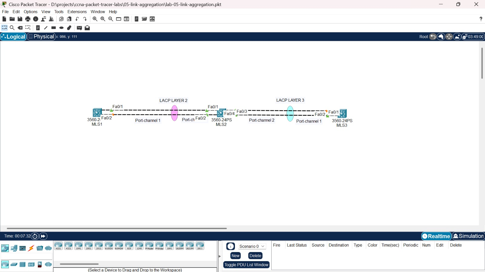

| Kabel | Port | Port-channel |
|---|---|---|
| MLS1 ke MLS2 | MLS1 Fa0/1 ke MLS2 Fa0/1 | Po1 di kedua sisi |
| MLS1 ke MLS2 | MLS1 Fa0/2 ke MLS2 Fa0/2 | Po1 di kedua sisi |
| MLS2 ke MLS3 | MLS2 Fa0/3 ke MLS3 Fa0/2 | Po2 di MLS2, Po1 di MLS3 |
| MLS2 ke MLS3 | MLS2 Fa0/4 ke MLS3 Fa0/1 | Po2 di MLS2, Po1 di MLS3 |

Seluruh switch adalah Cisco 3560-24PS.

### IP Address untuk pengujian

| Perangkat | Interface | IP Address |
|---|---|---|
| MLS1 | Vlan 1 | 192.168.1.1/24 |
| MLS2 | Vlan 1 | 192.168.1.2/24 |
| MLS2 | Port-channel 2 | 10.0.23.1/30 |
| MLS3 | Port-channel 1 | 10.0.23.2/30 |

## Isi folder

```text
05-link-aggregation/
├── lab-05-link-aggregation.pkt
├── screenshots/
├── configs/
│   ├── mls1.txt
│   ├── mls2.txt
│   └── mls3.txt
└── README.md
```

## Konsep singkat

- **EtherChannel** menggabungkan beberapa kabel fisik menjadi satu link logis bernama Port-channel. Bandwidth bertambah, dan kalau satu kabel putus, link logisnya tetap hidup lewat kabel yang tersisa.
- **LACP** (802.3ad) adalah protokol standar yang membuat kedua switch bernegosiasi sebelum bundel terbentuk. Mode `active` berarti switch mengajak lawannya bernegosiasi.
- **EtherChannel Layer 2** berupa switchport (di sini trunk) dan membawa VLAN.
- **EtherChannel Layer 3** berupa routed port (`no switchport`) dan diberi IP langsung di Port-channel.

## Kondisi awal

Sebelum dibundel, tiap pasang kabel diperlakukan sebagai dua link terpisah. STP memblokir salah satunya agar tidak terjadi loop, sehingga separuh kapasitas tidak terpakai. Titik oranye di topologi menandai port yang diblok.

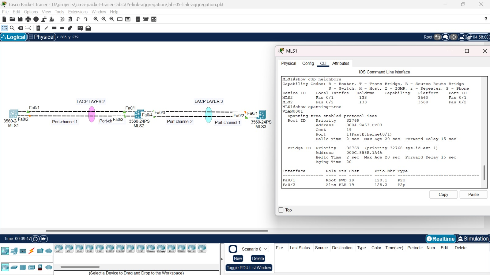

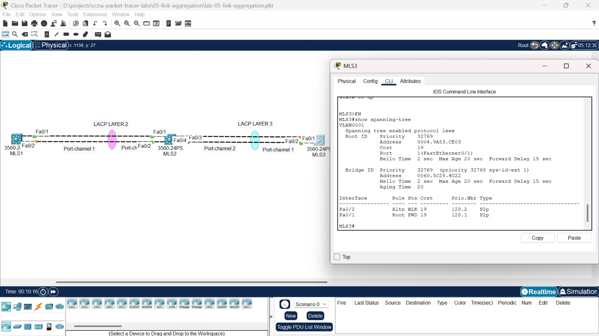

## Konfigurasi

### 1. EtherChannel Layer 2 (MLS1 dan MLS2)

Port-channel dibuat dulu dan diatur sebagai trunk, lalu kedua port fisik diberi pengaturan yang sama dan dimasukkan ke grup dengan LACP mode active. Pada switch 3560, `switchport trunk encapsulation dot1q` harus diatur sebelum `switchport mode trunk`.

**MLS1**

```text
hostname MLS1
interface port-channel 1
 switchport trunk encapsulation dot1q
 switchport mode trunk
interface range fastEthernet 0/1 - 2
 switchport trunk encapsulation dot1q
 switchport mode trunk
 channel-group 1 mode active
interface vlan 1
 ip address 192.168.1.1 255.255.255.0
 no shutdown
ip default-gateway 192.168.1.2
```

**MLS2 (bagian Layer 2)**

```text
hostname MLS2
interface port-channel 1
 switchport trunk encapsulation dot1q
 switchport mode trunk
interface range fastEthernet 0/1 - 2
 switchport trunk encapsulation dot1q
 switchport mode trunk
 channel-group 1 mode active
interface vlan 1
 ip address 192.168.1.2 255.255.255.0
 no shutdown
```

Port-channel 1 berstatus SU (Layer 2, in use) dengan protokol LACP, dan kedua port anggota berflag P (bundled).

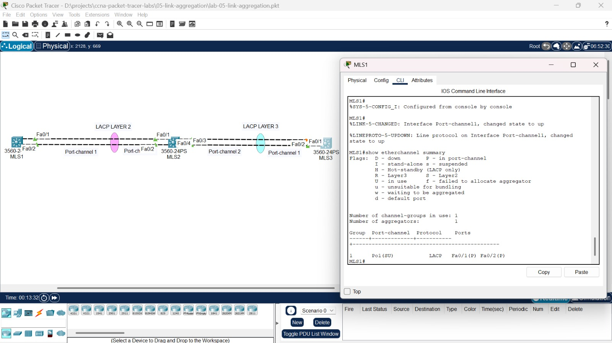

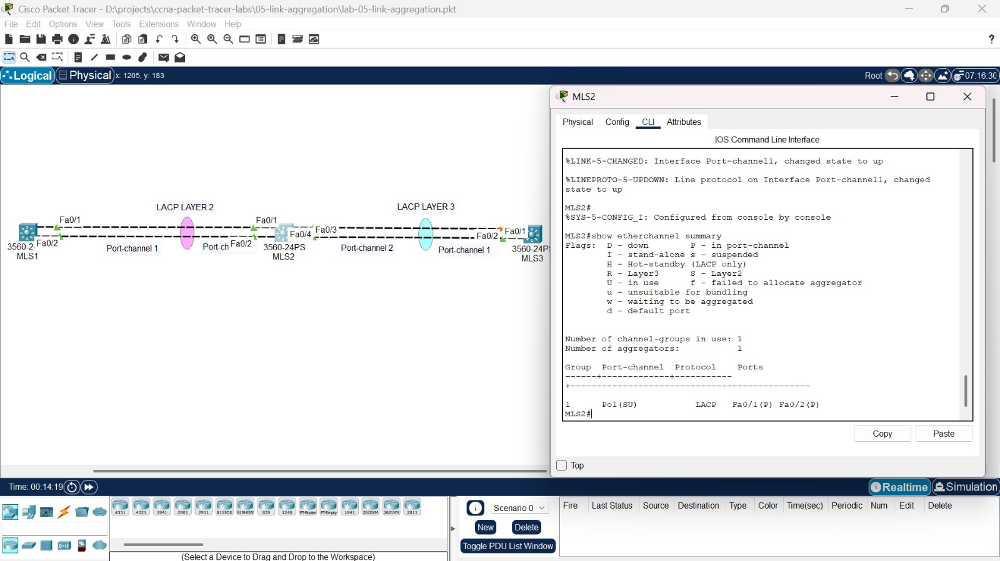

Pada `show interfaces trunk`, yang tampil adalah Port-channel 1, bukan lagi dua port terpisah.

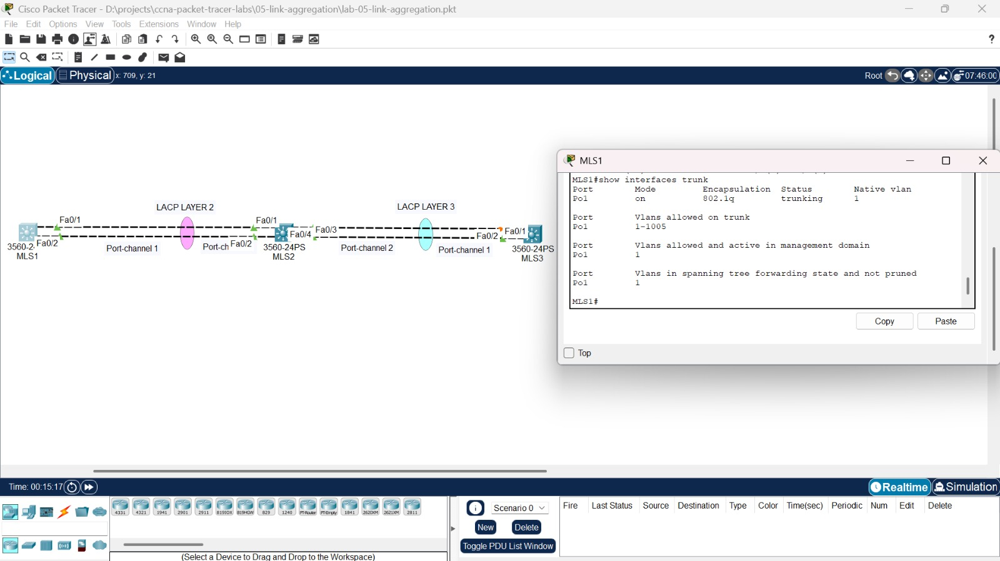

Ping antar kedua switch lewat bundel Layer 2 berhasil.

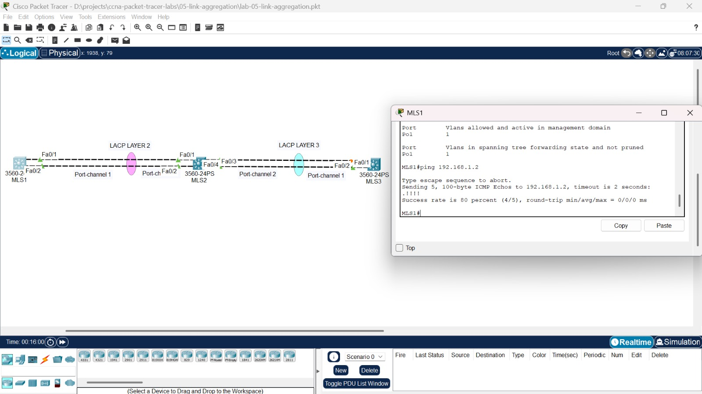

### 2. EtherChannel Layer 3 (MLS2 dan MLS3)

Port-channel dijadikan routed port dengan `no switchport` dan diberi IP. Urutan perintahnya penting: Port-channel dibuat dan dijadikan routed lebih dulu, lalu port fisik dijadikan routed, baru dimasukkan ke grup. `ip routing` mengaktifkan fungsi routing di switch.

**MLS2 (bagian Layer 3)**

```text
ip routing
interface port-channel 2
 no switchport
 ip address 10.0.23.1 255.255.255.252
interface range fastEthernet 0/3 - 4
 no switchport
 channel-group 2 mode active
```

**MLS3**

```text
hostname MLS3
ip routing
interface port-channel 1
 no switchport
 ip address 10.0.23.2 255.255.255.252
interface range fastEthernet 0/1 - 2
 no switchport
 channel-group 1 mode active
ip route 192.168.1.0 255.255.255.0 10.0.23.1
```

Port-channel berstatus RU (Layer 3, in use), dan kedua port anggota berflag P.

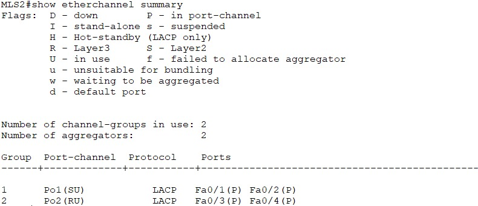

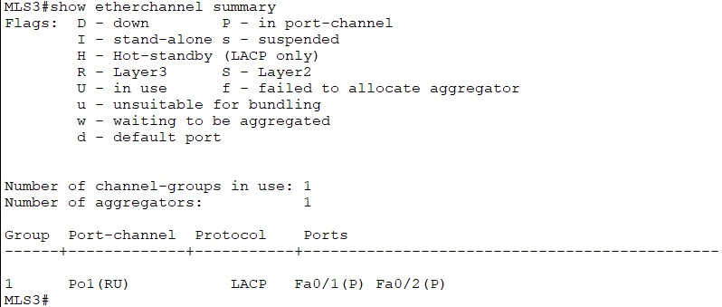

Port-channel menerima IP dan berstatus up/up.

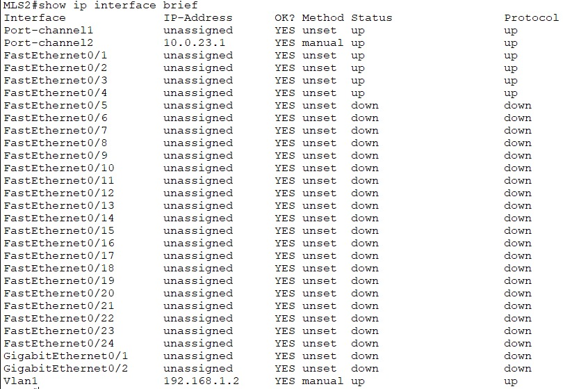

Ping antara MLS2 dan MLS3 lewat bundel Layer 3 berhasil.

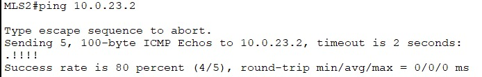

## Tes ujung ke ujung

Ping dari MLS1 ke MLS3 melewati kedua bundel sekaligus, Port-channel 1 di sisi Layer 2 lalu Port-channel 2 di sisi Layer 3.

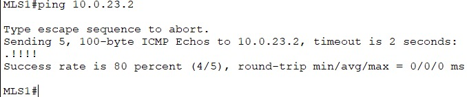

## Tes kabel putus

Fa0/1 di MLS1 dimatikan untuk membuktikan bahwa bundel tetap hidup lewat kabel yang tersisa. Port-channel 1 tetap berstatus SU, Fa0/1 berflag D (down), dan Fa0/2 tetap P.

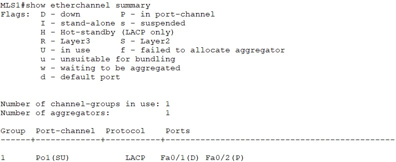

Ping tetap berhasil selama satu kabel mati.

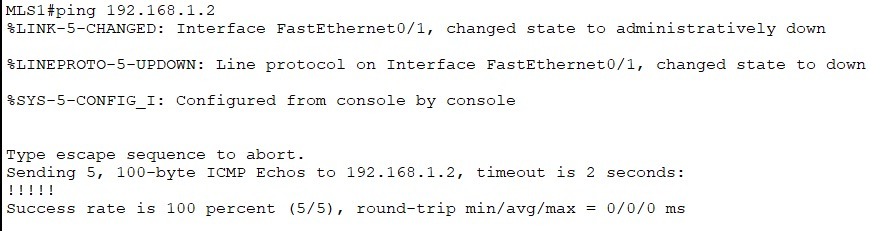

Setelah Fa0/1 dinyalakan kembali, kedua port kembali masuk bundel dan semua titik di topologi hijau. Tidak ada lagi port yang diblok oleh STP.


## Yang dipelajari

- Membuat EtherChannel dengan LACP dan membaca `show etherchannel summary` (flag SU, RU, P, D)
- Membedakan EtherChannel Layer 2 (trunk) dan Layer 3 (routed port dengan IP)
- Memahami urutan konfigurasi yang benar pada switch 3560, terutama untuk Layer 3
- Membuktikan redundansi lewat uji kabel putus, serta melihat bahwa bundel menghilangkan pemblokiran STP pada link paralel
