# Lab 06: HSRP (Hot Standby Router Protocol)

Lab ini membuat dua router gateway berbagi satu IP virtual, sehingga PC tetap bisa keluar ke internet walaupun salah satu gateway mati. GATEWAY-R1 menjadi router Active, dan GATEWAY-R2 menjadi Standby yang siap mengambil alih. Sisi internet disimulasikan oleh router ISP, dan NAT dipakai di tiap gateway supaya balasan dari ISP bisa kembali ke PC.

Dibuat dengan Cisco Packet Tracer 8.2.2.

## Topologi

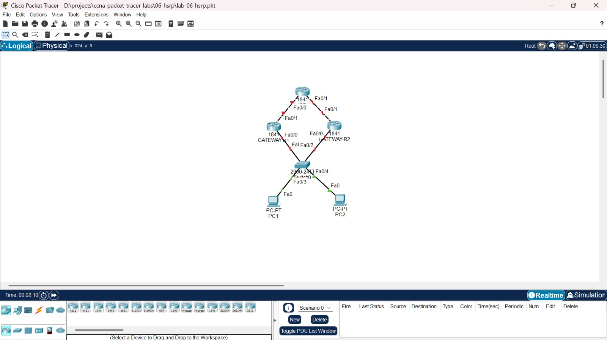

| Kabel | Ujung 1 | Ujung 2 |
|---|---|---|
| ISP ke GATEWAY-R1 | ISP Fa0/0 | GATEWAY-R1 Fa0/1 |
| ISP ke GATEWAY-R2 | ISP Fa0/1 | GATEWAY-R2 Fa0/1 |
| GATEWAY-R1 ke Switch0 | GATEWAY-R1 Fa0/0 | Switch0 Fa0/1 |
| GATEWAY-R2 ke Switch0 | GATEWAY-R2 Fa0/0 | Switch0 Fa0/2 |
| PC1 ke Switch0 | PC1 Fa0 | Switch0 Fa0/3 |
| PC2 ke Switch0 | PC2 Fa0 | Switch0 Fa0/4 |

### IP Address

| Perangkat | Interface | IP Address |
|---|---|---|
| ISP | Fa0/0 | 100.1.1.1/24 |
| ISP | Fa0/1 | 200.1.1.1/24 |
| ISP | Loopback0 | 8.8.8.8/32 (mewakili internet) |
| GATEWAY-R1 | Fa0/0 | 192.168.1.1/24 |
| GATEWAY-R1 | Fa0/1 | dari DHCP ISP (100.1.1.x) |
| GATEWAY-R2 | Fa0/0 | 192.168.1.2/24 |
| GATEWAY-R2 | Fa0/1 | dari DHCP ISP (200.1.1.x) |
| IP virtual HSRP | | 192.168.1.100 |
| PC1 | Fa0 | 192.168.1.101/24, gateway 192.168.1.100 |
| PC2 | Fa0 | 192.168.1.102/24, gateway 192.168.1.100 |

## Isi folder

```text
06-hsrp/
├── lab-06-hsrp.pkt
├── screenshots/
├── configs/
│   ├── isp.txt
│   ├── gateway-r1.txt
│   └── gateway-r2.txt
└── README.md
```

## Konsep singkat

- **HSRP** membuat dua router berbagi satu IP virtual. PC memakai IP virtual itu sebagai gateway, dan hanya satu router yang menjawab (Active). Router lainnya siaga (Standby) dan mengambil alih kalau router aktif mati. PC tidak perlu mengubah pengaturan apa pun saat peralihan terjadi.
- **Priority** menentukan siapa yang menjadi Active. Nilai terbesar menang, dan nilai default adalah 100.
- **Preempt** membuat router berprioritas tinggi merebut kembali peran Active setelah pulih.
- **NAT overload** menyamarkan IP PC menjadi IP WAN gateway. Ini diperlukan karena ISP tidak punya rute ke jaringan 192.168.1.0/24, sehingga balasan tidak akan kembali ke PC tanpa NAT.

## Kondisi awal

File awal hanya berisi konfigurasi ISP dan IP di PC. ISP sudah punya IP di kedua interface, loopback 8.8.8.8, dan dua DHCP pool untuk jaringan WAN gateway. Kedua gateway masih kosong: semua interface shutdown dan tanpa IP. Gateway di PC sudah diarahkan ke 192.168.1.100, yaitu IP virtual HSRP yang harus dibuat.

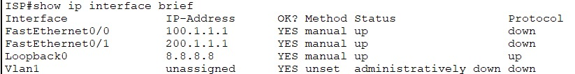

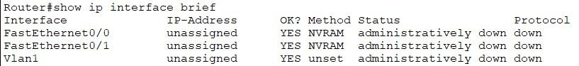

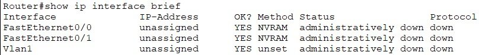

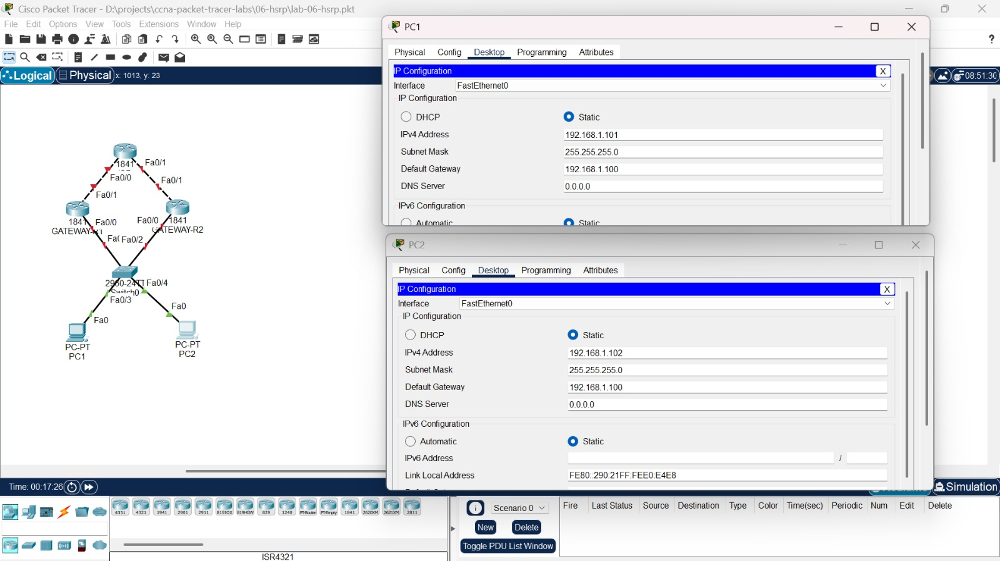

## Konfigurasi

GATEWAY-R1 dibuat Active dengan priority 110. GATEWAY-R2 memakai priority default (100) sebagai cadangan. Keduanya memakai `preempt`. Sisi LAN (Fa0/0) menjalankan HSRP dan menjadi `ip nat inside`, sedangkan sisi ISP (Fa0/1) mengambil IP lewat DHCP dan menjadi `ip nat outside`.

**GATEWAY-R1**

```text
hostname GATEWAY-R1
interface fastEthernet 0/0
 ip address 192.168.1.1 255.255.255.0
 ip nat inside
 standby 1 ip 192.168.1.100
 standby 1 priority 110
 standby 1 preempt
 no shutdown
interface fastEthernet 0/1
 ip address dhcp
 ip nat outside
 no shutdown
access-list 1 permit 192.168.1.0 0.0.0.255
ip nat inside source list 1 interface fastEthernet 0/1 overload
ip route 0.0.0.0 0.0.0.0 100.1.1.1
```

**GATEWAY-R2**

```text
hostname GATEWAY-R2
interface fastEthernet 0/0
 ip address 192.168.1.2 255.255.255.0
 ip nat inside
 standby 1 ip 192.168.1.100
 standby 1 priority 100
 standby 1 preempt
 no shutdown
interface fastEthernet 0/1
 ip address dhcp
 ip nat outside
 no shutdown
access-list 1 permit 192.168.1.0 0.0.0.255
ip nat inside source list 1 interface fastEthernet 0/1 overload
ip route 0.0.0.0 0.0.0.0 200.1.1.1
```

## Verifikasi

Kedua gateway mendapat IP WAN dari DHCP ISP, dan semua interface berstatus up/up.

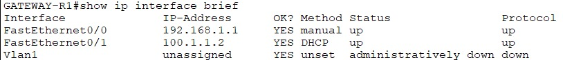

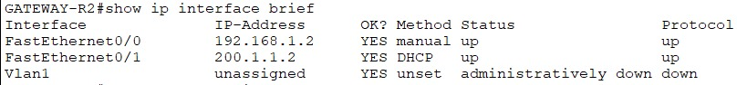

`show standby brief` menunjukkan GATEWAY-R1 sebagai Active (priority 110) dan GATEWAY-R2 sebagai Standby (priority 100), dengan virtual IP 192.168.1.100.

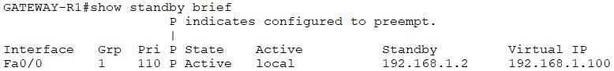

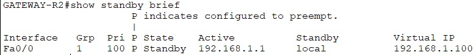

## Tes kondisi normal

Dari PC1, ping ke IP virtual dan ke 8.8.8.8 berhasil. `tracert` menunjukkan hop pertama 192.168.1.1 (GATEWAY-R1 sebagai Active), lalu langsung 8.8.8.8. ISP tidak muncul sebagai hop terpisah karena 8.8.8.8 adalah loopback milik ISP itu sendiri.

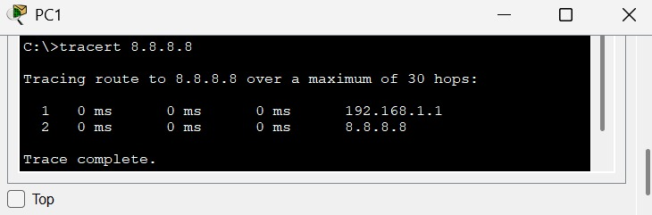

Tabel NAT di GATEWAY-R1 menunjukkan IP PC yang diterjemahkan ke IP WAN gateway.

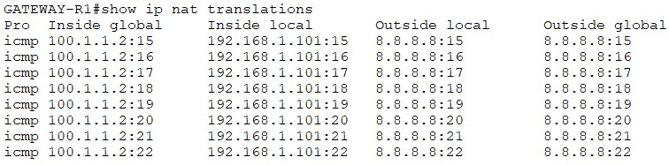

## Tes failover

Interface LAN GATEWAY-R1 (Fa0/0) dimatikan dengan `shutdown`. Setelah sekitar 10 detik (hold time HSRP), GATEWAY-R2 berubah menjadi Active.

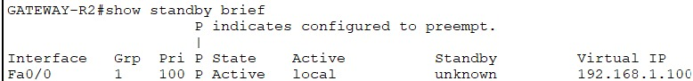

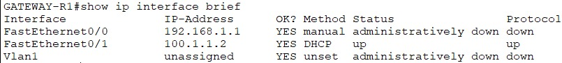

Gateway di PC1 tidak diubah sama sekali (tetap 192.168.1.100), tapi `tracert` sekarang melewati 192.168.1.2 (GATEWAY-R2), dan ping ke 8.8.8.8 tetap berhasil.

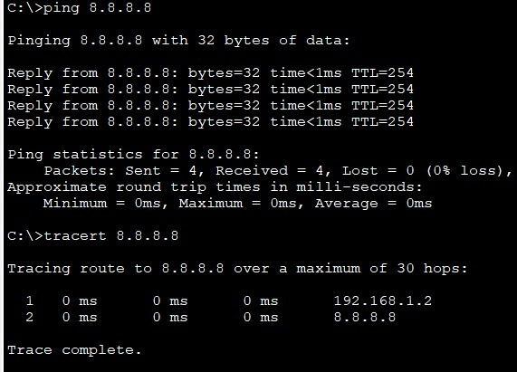

## Tes preempt

Fa0/0 di GATEWAY-R1 dinyalakan kembali. Karena `preempt` aktif dan priority-nya lebih tinggi, GATEWAY-R1 merebut kembali peran Active.

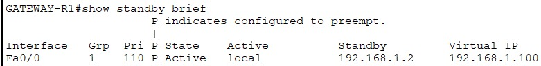

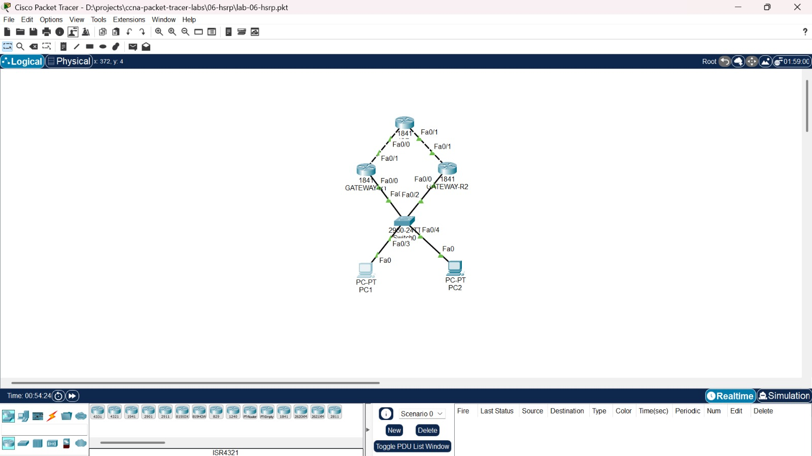

## Catatan

Perintah `standby track` sempat dicoba dalam dua bentuk, yaitu langsung menyebut interface dan lewat track object. Keduanya ditolak Packet Tracer 8.2.2 pada router 1841 dengan pesan `Invalid input`. Karena itu failover diuji dengan mematikan interface LAN GATEWAY-R1. Pada perangkat sungguhan, tracking dipakai supaya priority turun saat jalur ke ISP putus, sehingga failover juga terjadi pada kasus itu dan tidak hanya saat sisi LAN mati.

## Yang dipelajari

- Mengonfigurasi HSRP dengan IP virtual, priority, dan preempt, serta membaca `show standby brief`
- Membuktikan failover dan preempt dengan mematikan interface dan melihat perubahan peran Active dan Standby
- Memakai NAT overload dan `ip address dhcp` pada interface WAN
- Memahami perbedaan antara failover yang dipicu sisi LAN dan yang dipicu jalur ke ISP, serta batas dukungan tracking di simulator
