# Lab 07: NAT dan GRE Tunnel

Lab ini menggabungkan dua topik: NAT dan GRE tunnel. Dua LAN privat dihubungkan lewat satu jaringan publik (R2 sebagai ISP). R1 memakai NAT overload agar PC bisa keluar, R3 memakai static NAT dan port forwarding agar servernya bisa diakses dari luar, dan GRE tunnel antara R1 dan R3 membuat kedua LAN privat bisa saling terhubung langsung walaupun R2 tidak punya rute ke alamat privat.

Dibuat dengan Cisco Packet Tracer 8.2.2.

## Topologi

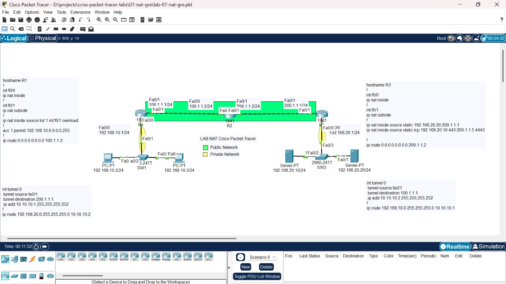

| Perangkat | Interface | IP Address |
|---|---|---|
| R1 | Fa0/0 (ke SW1) | 192.168.10.1/24 |
| R1 | Fa0/1 (ke R2) | 100.1.1.1/24 |
| R2 | Fa0/0 (ke R1) | 100.1.1.2/24 |
| R2 | Fa0/1 (ke R3) | 200.1.1.2/24 |
| R3 | Fa0/1 (ke R2) | 200.1.1.1/24 |
| R3 | Fa0/0 (ke SW3) | 192.168.20.1/24 |
| R1 | Tunnel0 | 10.10.10.1/30 |
| R3 | Tunnel0 | 10.10.10.2/30 |

| Perangkat | IP Address | Gateway | DNS |
|---|---|---|---|
| PC | 192.168.10.2/24 | 192.168.10.1 | 200.1.1.1 |
| PC | 192.168.10.3/24 | 192.168.10.1 | 200.1.1.1 |
| Server (web) | 192.168.20.10/24 | 192.168.20.1 | 192.168.20.20 |
| Server (DNS) | 192.168.20.20/24 | 192.168.20.1 | 192.168.20.20 |

## Isi folder

```text
07-nat-gre/
├── lab-07-nat-gre.pkt
├── screenshots/
├── configs/
│   ├── r1.txt
│   ├── r2.txt
│   └── r3.txt
└── README.md
```

## Konsep singkat

- **NAT overload (PAT)** membuat banyak host privat berbagi satu IP publik, dibedakan lewat nomor port.
- **Static NAT** memetakan satu alamat privat ke satu alamat publik secara tetap, sehingga host privat itu bisa dijangkau dari luar.
- **Port forwarding** adalah static NAT yang berlaku untuk satu port saja, misalnya akses ke port 4443 di alamat publik diteruskan ke port 443 di server privat.
- **GRE tunnel** adalah link virtual antara dua router. Paket privat dibungkus dengan header GRE yang beralamat IP publik, sehingga jaringan perantara hanya melihat lalu lintas antar alamat publik.

## Kondisi awal

File awal hanya berisi IP di interface router, PC, dan server. Belum ada NAT, rute, maupun tunnel. Ping dari PC ke server di LAN kanan gagal, karena R1 tidak punya rute ke 192.168.20.0/24, dan R2 sebagai ISP tidak mengenal alamat privat.

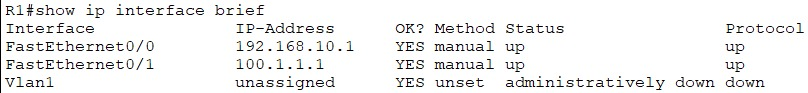

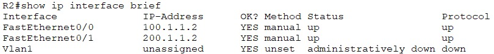

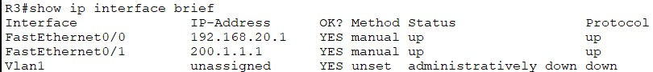

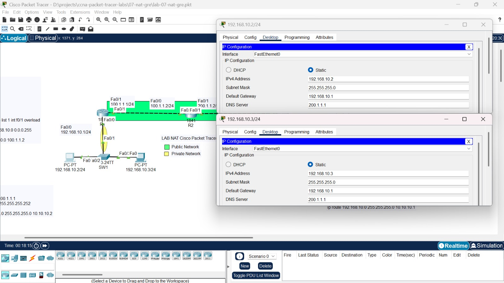

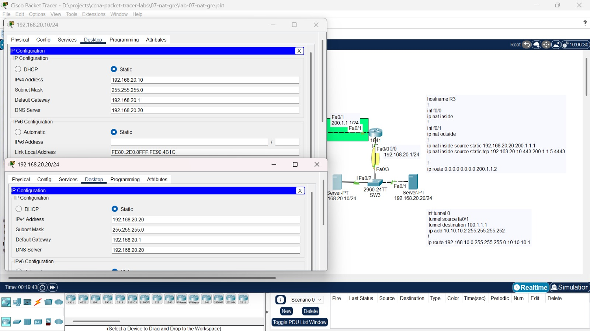

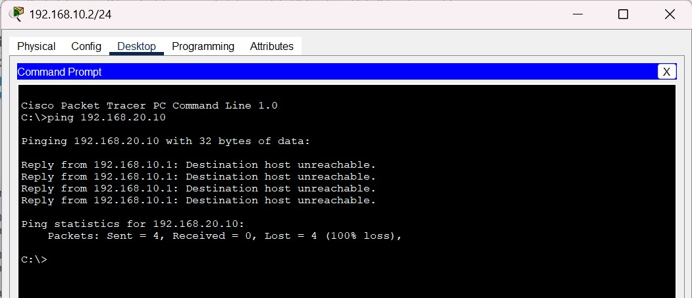

## Bagian 1: NAT overload di R1

Access-list 1 menentukan alamat yang boleh menyamar, `ip nat inside` dan `ip nat outside` menandai sisi LAN dan sisi publik, dan `overload` membuat semua PC berbagi IP publik 100.1.1.1. Rute default mengarahkan paket ke jaringan publik lewat R2.

**R1**

```text
access-list 1 permit 192.168.10.0 0.0.0.255
interface fastEthernet 0/0
 ip nat inside
interface fastEthernet 0/1
 ip nat outside
ip nat inside source list 1 interface fastEthernet 0/1 overload
ip route 0.0.0.0 0.0.0.0 100.1.1.2
```

**R3 (penandaan sisi dan rute default)**

```text
interface fastEthernet 0/0
 ip nat inside
interface fastEthernet 0/1
 ip nat outside
ip route 0.0.0.0 0.0.0.0 200.1.1.2
```

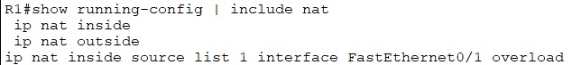

Ping dari PC ke R2 berhasil, dan tabel NAT di R1 menunjukkan alamat PC diterjemahkan menjadi 100.1.1.1.

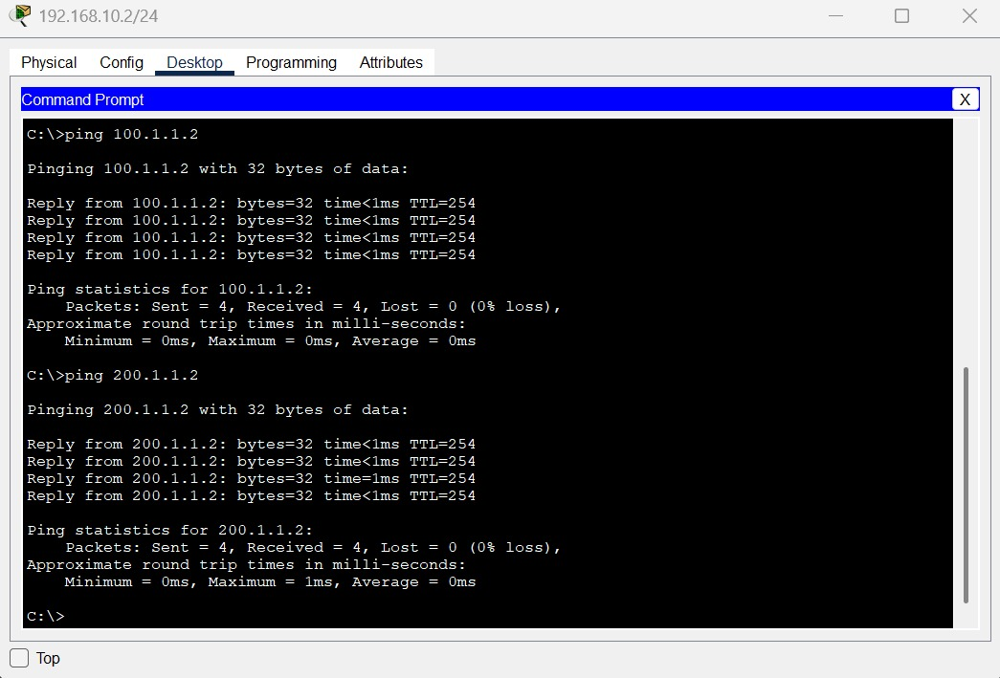

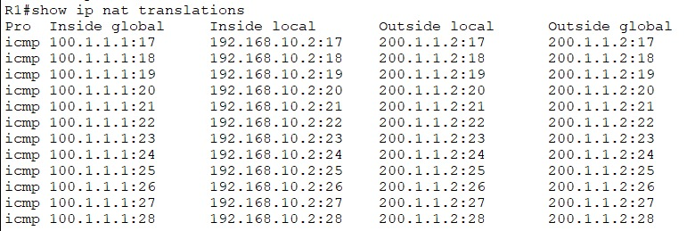

Pada tahap ini, DNS belum bisa dipakai. PC bertanya ke 200.1.1.1, tapi alamat itu milik R3 sendiri dan R3 tidak menjalankan DNS, sehingga `nslookup` gagal.

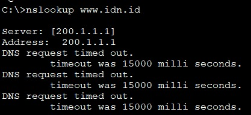

## Bagian 2: GRE tunnel antara R1 dan R3

Tunnel memakai alamat publik kedua router sebagai ujung (100.1.1.1 dan 200.1.1.1), dan alamat 10.10.10.0/30 sebagai alamat di dalam tunnel. Rute static mengarahkan LAN seberang lewat tunnel. Karena lebih spesifik daripada rute default, rute inilah yang dipakai untuk lalu lintas antar LAN. Lalu lintas lewat tunnel juga tidak terkena NAT, karena Tunnel0 tidak ditandai `ip nat outside`.

**R1**

```text
interface tunnel 0
 tunnel source fastEthernet 0/1
 tunnel destination 200.1.1.1
 ip address 10.10.10.1 255.255.255.252
ip route 192.168.20.0 255.255.255.0 10.10.10.2
```

**R3**

```text
interface tunnel 0
 tunnel source fastEthernet 0/1
 tunnel destination 100.1.1.1
 ip address 10.10.10.2 255.255.255.252
ip route 192.168.10.0 255.255.255.0 10.10.10.1
```

Kedua ujung tunnel berstatus up, dengan jenis GRE/IP.

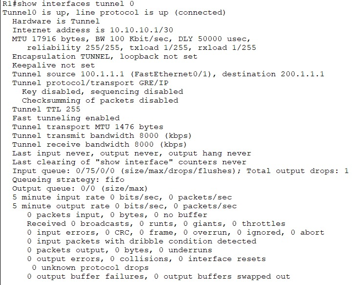

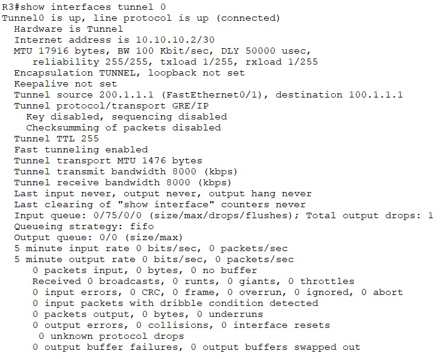

Tabel routing R1 memuat rute ke LAN kanan lewat 10.10.10.2, dan ping antar ujung tunnel berhasil.

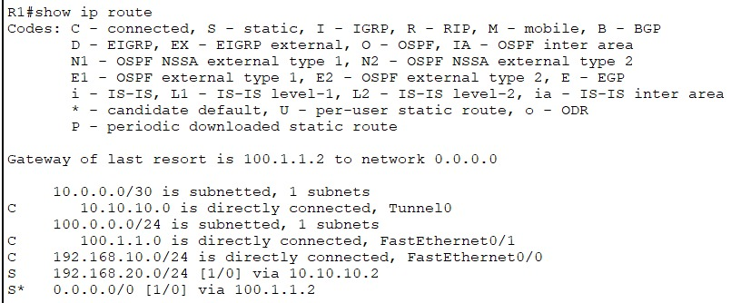

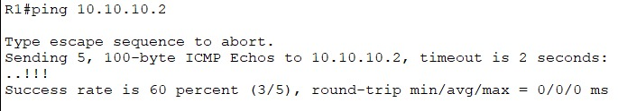

PC di LAN kiri sekarang bisa menjangkau server di LAN kanan, berbeda dengan kondisi awal. `tracert` menunjukkan lalu lintas melewati 10.10.10.2 dan R2 tidak muncul sebagai hop, yang membuktikan paketnya berjalan lewat tunnel.

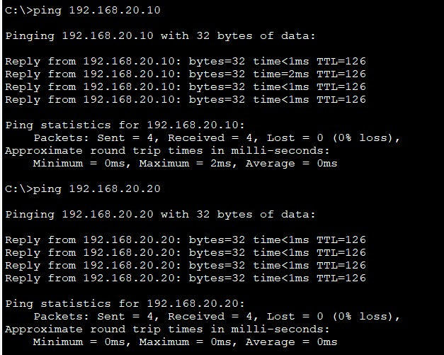

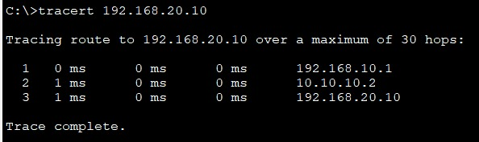

## Bagian 3: Static NAT dan port forwarding di R3

Baris pertama memetakan server DNS (192.168.20.20) satu-satu ke 200.1.1.1, sehingga PC bisa memakai 200.1.1.1 sebagai alamat DNS. Baris kedua meneruskan akses ke 200.1.1.5 port 4443 menuju web server (192.168.20.10) port 443.

**R3**

```text
ip nat inside source static 192.168.20.20 200.1.1.1
ip nat inside source static tcp 192.168.20.10 443 200.1.1.5 4443
```

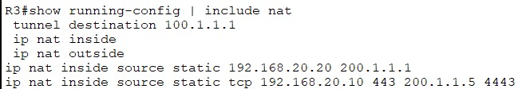

Record DNS di server awalnya mengarahkan www.idn.id ke 192.168.20.2, alamat yang tidak dipakai perangkat mana pun. Record itu diubah menjadi 200.1.1.5, yaitu alamat publik yang dipetakan ke web server, supaya PC di luar LAN kanan bisa mencapainya.

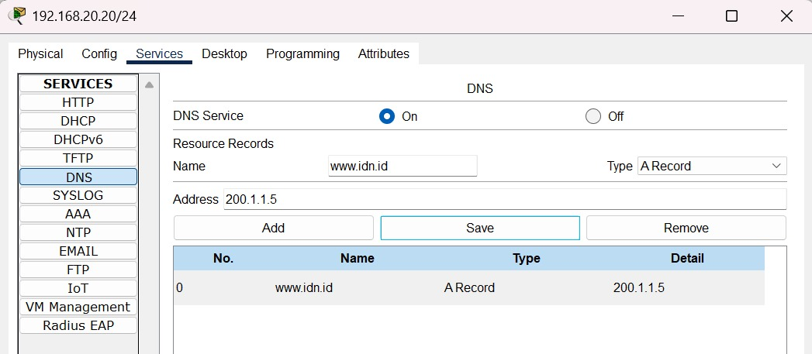

Setelah static NAT dipasang, `nslookup www.idn.id` berhasil dan menjawab 200.1.1.5, dan ping ke 200.1.1.1 dibalas oleh server DNS.

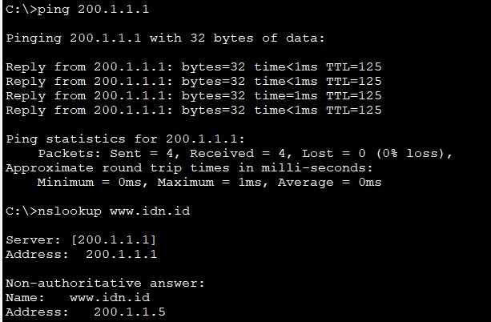

Tabel NAT di R3 memuat entri untuk pemetaan ini.

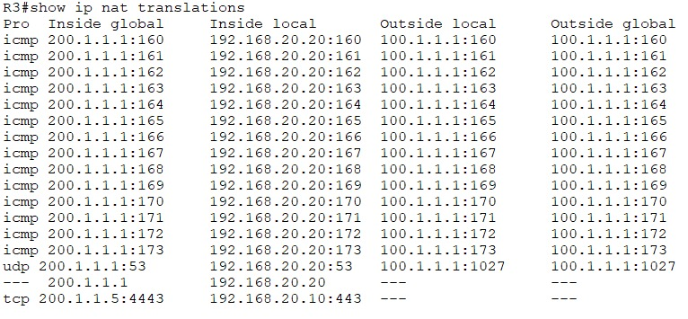

Web server dapat diakses dari PC lewat nama domain dan port yang dibuka oleh port forwarding.

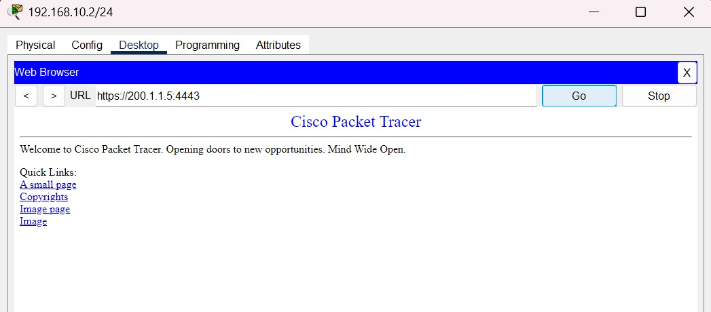

Setelah static NAT dipasang, tunnel diperiksa lagi dan tetap berfungsi.

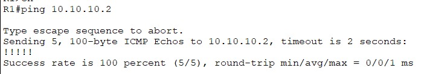

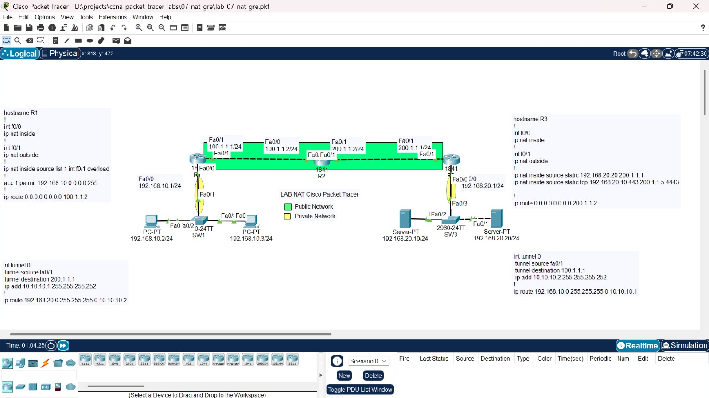

## Catatan

- Static NAT di R3 memetakan server ke 200.1.1.1, yang juga merupakan alamat interface R3 dan tujuan tunnel dari R1. Di Packet Tracer tunnel tetap berfungsi setelah static NAT dipasang. Pada perangkat sungguhan, pemetaan satu-satu ke alamat interface bisa menelan paket GRE yang menuju router itu, jadi praktik yang lebih aman adalah memetakan hanya port yang dibutuhkan, misalnya UDP dan TCP 53 untuk DNS.
- Record DNS bawaan (192.168.20.2) diganti menjadi 200.1.1.5. Tanpa perubahan itu, nama www.idn.id akan menunjuk ke alamat yang tidak ada.

## Yang dipelajari

- Mengonfigurasi NAT overload, static NAT, dan port forwarding, serta membaca `show ip nat translations`
- Membuat GRE tunnel dan mengarahkan lalu lintas lewat tunnel dengan static route
- Membuktikan tunnel bekerja dengan `tracert` yang tidak melewati router ISP
- Menghubungkan DNS, static NAT, dan port forwarding menjadi satu alur akses ke server dari luar
